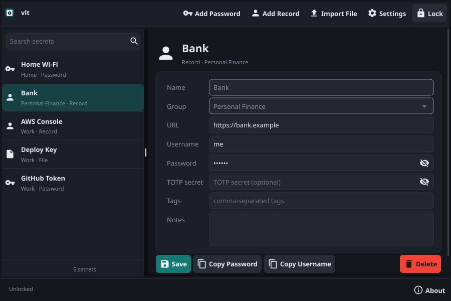
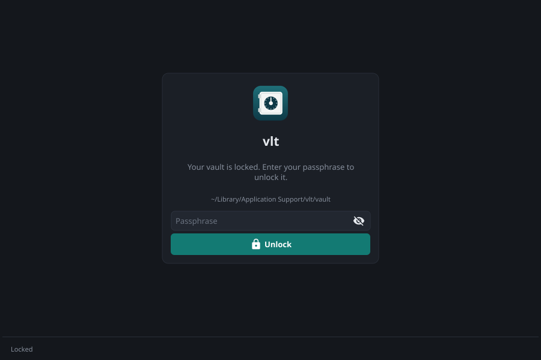

# vlt

A cross-platform GUI secret manager using [age](https://age-encryption.org/) encryption.

vlt replaces ad-hoc PGP-encrypted text file workflows with a structured, portable vault. Secrets are stored as individual `.age` files in a directory, organised by group, unlocked by a single passphrase. The only key material on disk is the vault key, stored encrypted to your passphrase inside the vault itself. The vault directory is fully portable — copy it anywhere and unlock with the same passphrase.

<p align="center">
  <picture>
    <source media="(prefers-color-scheme: light)" srcset="docs/screenshots/light-main.png">
    
  </picture>
</p>

<p align="center">
  
</p>

vlt follows the system's light or dark mode. `make screenshots` re-renders the main view and the unlock screen, in dark and light mode, into `docs/screenshots/` with Fyne's software renderer, from made-up sample secrets; no display is needed.

## Features

- **Passphrase-only unlock** — no external key files, no OS keychain dependency
- **Safe vault creation** — when no vault exists at the configured location (first run, or after switching to an empty or missing folder), a dedicated screen shows where the vault will be created and asks for the passphrase twice (at least 12 characters not counting leading or trailing spaces; five or more random words recommended), so a typo can never become the passphrase. The same screen offers *Open Existing Vault…* to pick a folder that already holds a vault, for example after the saved location was lost, and *Use a Vault on a Server…* for one on an SSH server (neither when `VLT_VAULT_DIR` sets the location). A folder without a vault is refused, with a pointer to the subfolder if you picked the folder above a vault, and the new location is saved once the vault unlocks. If the vault directory cannot be read (for example, permission denied) or its server cannot be reached, vlt shows the error and a Retry button rather than offering to create a vault over it
- **age encryption** — each secret is an individual `.age` file encrypted to a random X25519 vault key; the vault key is encrypted to your passphrase with scrypt, so unlocking costs one scrypt derivation however many secrets you have
- **Secure memory (best-effort)** — the vault key's encoded form is held in mlock'd memory via memguard and destroyed on lock; passphrase fields are cleared as soon as they are read, and on lock loaded secrets are emptied and vlt's references to them dropped. Go cannot wipe strings, so the parsed key and secret text live on the heap until garbage-collected
- **Secret types** — passwords, structured login records (URL/username/password/TOTP; the password and TOTP secret are masked), and encrypted files
- **Groups** — organise secrets into groups (work, personal, etc.) with a dropdown that shows existing groups and accepts new ones
- **Search** — instant filter across secret names, groups, and tags
- **Clipboard safety** — copied values are cleared after a configurable TTL (default 30s) with a countdown in the status bar. Each copy gets its own full TTL; the clipboard is cleared only if it still holds the value vlt copied (anything you copied since from another app is left alone); locking the vault or quitting vlt clears it immediately
- **Auto-lock** — vault locks after a configurable period of inactivity (default 5 minutes), zeroing the vault key from memory. Typing, pressing buttons, selecting secrets, moving sliders and answering dialogs count as activity; scrolling and pointer movement do not. With a timeout of a minute or more, a warning appears 30 seconds before locking: *Stay unlocked* (or any other input) restarts the countdown and *Lock now* locks immediately
- **File import/export** — import files via picker (base64-encoded, MIME detected, 10 MiB limit, SHA-256 shown on completion), export to disk via save dialog. Reading, encoding and writing run in the background. A read error fails the import and saves nothing; a failed export write or close is reported and the partial file is removed where possible. Dialogs left open (including file pickers) are dismissed when the vault locks, so an export can never be written after a lock
- **Passphrase verification** — a wrong passphrase fails immediately when `vlt.age` (the wrapped vault key) cannot be decrypted
- **Change passphrase** — atomically rewrites only `vlt.age`; secrets are never re-encrypted, so an interrupted change leaves the old passphrase working
- **Automatic migration** — vaults from earlier versions (every secret encrypted directly to the passphrase) are upgraded on first unlock; the upgrade is crash-safe and resumes if interrupted
- **Move/switch vault** — copy secrets (including the wrapped key) to a new location, or point to a different vault directory
- **Vaults on a server** — keep the vault in a folder on an SSH server (`me@nas.example:/home/me/vault`), reached with your own ssh setup. Encryption stays on your computer: secrets and the vault key are encrypted before they are sent. See [Vaults on a Server](#vaults-on-a-server)
- **Open-elsewhere warning** — a lock file (`vlt.lock`) records who has the vault open; opening a vault that another copy of vlt has open asks first, because if both save the same secret the last save wins
- **About and bug reports** — *About* in the status bar (on every screen, locked or not) and the *About* menu item (*vlt → About vlt* on macOS, *Help → About* elsewhere) show the version, commit, platform and Go and Fyne versions, with *Copy Details* and *Report a Bug…*, which opens a new GitHub issue with those details filled in. The details never include secrets, paths or names
- **Cross-platform** — Linux, macOS, Windows, OpenBSD

## Vault Structure

```
vault/
├── vlt.age                  # Vault key, encrypted to the passphrase (scrypt)
├── vlt.json                 # Format marker: {"format":2}
├── vlt.lock                 # Who has the vault open (while vlt has it unlocked)
├── work/
│   ├── github-api-key.age
│   └── jira-login.age
├── personal/
│   ├── email.age
│   └── bank-login.age
└── default/
    └── misc-token.age
```

- Secrets are stored at `vault/<group>/<slug>.age`
- Groups are plain subdirectories, created on demand. The directory is the slugified group name; the secret keeps the group name as you typed it (`Personal Finance` is shown as typed and stored in `personal-finance/`). Group names that slugify to the same directory are one group, and a new or imported secret typed into `personal finance` joins an existing `Personal Finance` group. A group name with no ASCII letter or digit becomes `default`.
- Filenames are slugified from the secret name (lowercase ASCII letters, digits and `-`). Names that slugify to the same filename, such as `GitHub Key` and `github-key`, cannot coexist in a group: creating one when the other exists is refused, and updating through the other name is refused. Names with no ASCII letter or digit, or whose filename would exceed 255 bytes, are rejected.
- No database, no index file — the directory structure is the index
- `vlt.lock` is written when a copy of vlt unlocks the vault and removed when it locks or quits. A copy that crashes leaves it behind; the next unlock on that computer takes it over. It holds that computer's host name, user name, process ID and when it opened the vault, never a secret. It is not part of the vault: Move and backups don't need it
- On a server, vlt also keeps `.vlt-tmp/`, a private folder for writes in progress. Dot-folders are never groups
- Every write is atomic: vlt writes a `.tmp-*` file beside the target, fsyncs it, renames it into place, and fsyncs the directory (skipped on Windows, where NTFS journals the rename). New group directories are fsynced into their parent too. A crash leaves either the old or the new file, never a partial one. Leftover `.tmp-*` files are ignored and can be deleted.
- Trivially Git-compatible (add `.tmp-*` to the vault's `.gitignore` so an interrupted write never shows up as untracked)

### Default Vault Location

| OS      | Path                                       |
|---------|--------------------------------------------|
| macOS   | `~/Library/Application Support/vlt/vault/` |
| Linux   | `$XDG_DATA_HOME/vlt/vault/` (default `~/.local/share/vlt/vault/`) |
| Windows | `%APPDATA%\vlt\vault\`                     |
| OpenBSD | `$XDG_DATA_HOME/vlt/vault/` (default `~/.local/share/vlt/vault/`) |

On Linux and OpenBSD, a relative `XDG_DATA_HOME` is ignored. A vault created by an earlier vlt in `~/.local/share/vlt/vault/` is still used when `XDG_DATA_HOME` points elsewhere and holds no vault.

Override with the `VLT_VAULT_DIR` environment variable, or move or switch the vault in Settings. If no vault is found at the location, the create screen can open one from another folder or use one on a server. The choice is saved (see [Configuration](#configuration)). Backups, uninstalling and restoring: see [Your Data](#your-data).

## Your Data

By default vlt keeps its data in your user folder, never inside the app, so removing or replacing the app doesn't touch your secrets.

- **Vault** (secrets and the vault key): see [Default Vault Location](#default-vault-location), or wherever you put it with Settings or `VLT_VAULT_DIR`.
- **Settings file**: macOS `~/Library/Preferences/fyne/io.github.heyjdp.vlt/preferences.json`; Linux and OpenBSD `$XDG_CONFIG_HOME/fyne/io.github.heyjdp.vlt/preferences.json` (default `~/.config/fyne/io.github.heyjdp.vlt/preferences.json`); Windows `%APPDATA%\fyne\io.github.heyjdp.vlt\preferences.json`. It holds the vault location, the auto-lock timeout, the clipboard TTL, the last folder used in a file dialog, and a marker (`migratedFrom010`) recording that 0.1.0's settings were checked. No secret, passphrase or key is ever stored there. vlt 0.1.0 kept it under `…/fyne/io.yourorg.vlt/`; later versions carry its vault location, auto-lock timeout and clipboard TTL over on their first start, and leave the old file in place.
- **Exported files** are decrypted copies saved wherever you chose. They are not part of the vault; delete them when you no longer need them.

**Uninstalling.** Deleting `vlt.app`, the AppImage or the binary leaves the vault and the settings file in place. Uninstaller tools such as AppCleaner often offer to delete `~/Library/Application Support/vlt` as well: that deletes the vault itself, so untick it unless you mean to. For a complete removal, delete the vault folder and the settings folder (`…/fyne/io.github.heyjdp.vlt/`). A vault on a server stays on the server.

**Reinstalling.** A reinstalled vlt finds the vault at the saved location and unlocks with the same passphrase, with every secret, group, tag and file as before. If the settings file was lost and the vault is not at the default location, vlt shows the create screen: choose *Open Existing Vault…* and pick the vault folder (or *Use a Vault on a Server…* and enter its location) instead of creating a new vault. If an older copy is still at the default location (*Move Vault* keeps the original), vlt opens that copy instead; use *Switch Vault (no copy)* in Settings to go back to the right folder.

**Backing up.** Copy the whole vault folder while vlt is locked or closed. The copy must include `vlt.age`: it holds the vault key, and without it no secret can be decrypted, even with the right passphrase. Secret contents are encrypted, so a backup can live on a USB drive or in cloud storage, and its contents are as strong as your passphrase. File and folder names are not encrypted: they show your group and secret names. Leftover `.tmp-*` files can be skipped. For a vault on a server, copy the folder from the server (`scp -r` or `rsync`), or use *Move Vault* in Settings to copy it to a local folder.

**Restoring or moving to a new computer.** Copy the vault folder back to where it was, and vlt finds it. Anywhere else: if vlt shows the create screen, choose *Open Existing Vault…* and pick the folder that contains `vlt.age`; if another vault is open, use *Switch Vault (no copy)* in Settings.

**Changing the passphrase** rewrites only `vlt.age`; the vault key stays the same. A backup's `vlt.age` still opens with the old passphrase, and that key decrypts your current secrets too. If you change the passphrase because it may have leaked, destroy backups made before the change.

**Forgetting the passphrase.** There is no recovery: the vault key is encrypted only to your passphrase, and no one can reset it. Keep a copy of it somewhere safe and offline.

## Vaults on a Server

A vault can live in a folder on an SSH server instead of on this computer. vlt reads and writes it over SFTP, using the system's `ssh` client, so it uses your `~/.ssh/config` (host aliases, users, ports, `ProxyJump`), your keys, `ssh-agent` and `known_hosts`.

**Locations.** Anywhere vlt takes a vault location (the create screen's *Use a Vault on a Server…*, Settings' Move and Switch, and `VLT_VAULT_DIR`), you can write:

| Form | Example | Notes |
|------|---------|-------|
| `[user@]host:path` | `me@nas.example:/home/me/vault` | Like `scp`. A relative path, or `~/path`, is relative to your home directory on the server |
| `ssh://[user@]host[:port]/path` | `ssh://me@nas.example:2222/srv/vault` | Needed for a port, or a one-letter host name. `ssh://host/~/vault` is under your home directory |
| IPv6 | `me@[fd00::1]:/srv/vault`, `ssh://[fd00::1]:22/srv/vault` | The address goes in brackets |

`host` can be a `Host` alias from `~/.ssh/config`. A user or port in the location overrides the config. Host and user names may hold only letters, digits, `.`, `_` and `-` (not first): ssh can substitute them into commands from your ssh config, so anything else is refused. The host must have two or more characters in the short form, so `C:\vault` is always a local path. A local path whose first colon comes before any slash, such as `vault:old`, reads as a server; write `./vault:old`.

**Setting it up.**
1. Connect once from a terminal (`ssh me@nas.example`) so the server's host key is in `known_hosts`. vlt runs ssh in batch mode, which never prompts, so an unknown host key is refused, unless your ssh config sets `StrictHostKeyChecking` to `accept-new` or `no` for that host: vlt passes no host-key options of its own. Hosts reached through `ProxyJump` must be known too.
2. Make sure your key works without a prompt: load it into `ssh-agent`, or use a key without a passphrase. Password logins are not supported. On macOS, `ssh-add --apple-use-keychain ~/.ssh/id_ed25519` stores the key's passphrase in the Keychain; add `UseKeychain yes` and `AddKeysToAgent yes` for the host in `~/.ssh/config` so it is loaded again after a restart.
3. In vlt, choose *Use a Vault on a Server…* on the create screen, or *Switch Vault (no copy)* in Settings, and enter the location. If a vault is there, vlt asks for its passphrase; if not, it offers to create one there. To put an existing vault on the server, use *Move Vault* in Settings with the server location.

vlt runs ssh without a terminal, with forwarding, `RemoteCommand` and `LocalCommand` turned off, so the session only carries SFTP. The server needs SFTP with OpenSSH's `posix-rename` and `hardlink` extensions (any OpenSSH `sftp-server`), so writes stay atomic and creating a secret never overwrites another; vlt refuses a server without them. Each file is written in a private folder in the vault, `.vlt-tmp` (mode 0700, so no other user can open a file before its own mode is set), then renamed into place. With OpenSSH's `fsync` extension, which vlt uses when offered, each file is flushed to disk before the rename. SFTP cannot flush a directory, so if the server itself crashes, the most recent change to a file can be lost (the previous version remains), but a file is never left half-written.

**What the server sees.** Secrets and the vault key are encrypted on your computer before they are sent, and your passphrase and decrypted secrets never leave your computer. Two small files are plain text: `vlt.json` (the format number) and `vlt.lock` (who has the vault open: a host name, a user name, a process ID and a time). Like any storage, the server sees the file and folder names (your group and secret names, slugified), file sizes and times. Whoever has the server's files can try passphrases against `vlt.age` offline, as with any copy of the vault, so your passphrase's strength is the protection. Whoever controls the server can also delete files, or put back an older copy of any file, which vlt cannot detect. Use a server you trust to keep your files, and keep backups.

**Connection.** vlt connects when it checks the location and when you unlock, and keeps the connection until the vault locks. If the connection drops, the operation that noticed fails with an error (listing the vault fails as a whole rather than showing some secrets) and the next one reconnects. Nothing is retried automatically, because a write may or may not have landed. A connection that silently dies is noticed after about 45 seconds. A vault on a server needs the server; there is no offline copy. If the server can't be reached when vlt checks the location, vlt shows the error with *Retry* and, unless `VLT_VAULT_DIR` sets the location or the vault already is the default one, *Use the Vault on This Computer* (the default local location). If it fails while unlocking, the error is shown on the unlock screen. Each secret is a file, so listing a large vault over a slow link takes a while; vlt reads up to 8 files at once.

**Two computers, one vault.** Both can use the vault. Creating a secret never overwrites one, but if both edit the same secret the last save wins. `vlt.lock` warns about this: unlocking a vault that another copy of vlt has open shows who has it and since when, and asks before going on. *Open Anyway* takes the lock over; *Cancel* closes the vault again. If the question is not answered within the auto-lock timeout, the vault is closed as if locked. A lock left by a copy of vlt that crashed on this computer is taken over without asking. Computers are told apart by host name, so two computers with the same name count as one. The lock only warns; it never keeps you out.

## Secret Envelope Format

Every `.age` file decrypts to a JSON envelope:

```json
{
  "version": 1,
  "type": "password",
  "name": "GitHub API Key",
  "group": "work",
  "created_at": "2026-03-14T10:00:00Z",
  "modified_at": "2026-03-14T10:00:00Z",
  "tags": ["github", "ci"],
  "notes": "Expires 2027-03-14",
  "value": "ghp_xxxxxxxxxxxx"
}
```

Three secret types share this structure:

- **password** — single-value secrets (API keys, tokens). Uses the `value` field.
- **record** — structured logins. Uses `username`, `password`, `url`, `totp_secret` fields.
- **file** — binary files (SSH keys, certificates). Uses `value` (base64), `original_filename`, `mime_type`, `encoding` fields. 10 MiB size limit.

## Requirements

- **Go 1.26.1+** — [install instructions](https://go.dev/doc/install), or `brew install go` on macOS. `go.mod` also names a patched toolchain (`toolchain go1.27.3`), which the `go` command downloads automatically if yours is older; it fixes standard-library vulnerabilities that `govulncheck` reports
- **A C compiler** — Fyne's desktop driver uses cgo (Xcode command-line tools on macOS, gcc on Linux, MinGW-w64 on Windows)
- **OpenGL/Metal** — required by Fyne for rendering (system libraries, no manual install needed on macOS/Windows; on Linux install `libgl1-mesa-dev xorg-dev libxkbcommon-dev`)
- **OpenBSD** — install `mesa-dri` via `pkg_add` for OpenGL support

### Optional Tools

| Tool | Purpose | Install |
|------|---------|---------|
| golangci-lint | Linting and formatting (gofumpt, goimports) | `go install github.com/golangci/golangci-lint/v2/cmd/golangci-lint@v2.15.0` |
| govulncheck | Vulnerability scanning | `go install golang.org/x/vuln/cmd/govulncheck@v1.9.0` |
| lefthook | Git hooks | `go install github.com/evilmartians/lefthook@latest` |

## Clone and Build

```bash
git clone https://github.com/heyjdp/vlt.git
cd vlt

# Install dependencies
go mod download

# Build (embeds the version from `git describe`, shown in the window title)
make build

# Or with go directly (the version shows as "dev")
go build -trimpath -ldflags="-s -w" -o vlt ./cmd/vlt

# Run
./vlt
```

Or run directly without building a binary:

```bash
go run ./cmd/vlt
```

### Building for Other Platforms

Fyne's desktop driver uses cgo (OpenGL and GLFW), so a plain `GOOS=… go build` cannot cross-compile vlt: it needs a C compiler and system headers for the target, and `CGO_ENABLED=0` does not build at all. Build on each target OS instead (this is what CI does on Linux, macOS and Windows runners):

```bash
go build -trimpath -ldflags="-s -w" -o vlt ./cmd/vlt
```

CI builds the release packages natively on macOS and Ubuntu runners (see [Packages](#packages)). [fyne-cross](https://github.com/fyne-io/fyne-cross) can build several platforms from one machine with Docker, but vlt doesn't use it. OpenBSD builds must be done on OpenBSD.

### Packages

CI builds both packages on every push to `main` and attaches them to the workflow run. Pushing a `v*` tag (for example `v0.1.0`) also publishes them as a GitHub release, with SHA-256 checksums. File names carry `git describe`'s version: the tag on a release (`v0.1.0`), or the tag, commit count and hash in between (`v0.1.0-5-gabc1234`).

| Package | Built on | Runs on |
|---------|----------|---------|
| `vlt-<version>-macos-arm64.zip` (`vlt.app`) | macOS 15 | Apple silicon Macs with macOS 13 or later |
| `vlt-<version>-x86_64.AppImage` | Ubuntu 22.04 | x86-64 Linux with glibc 2.35 or later, OpenGL and an X11 or XWayland session |

**macOS.** The app is ad-hoc signed but not notarised, so macOS blocks its first launch. Move `vlt.app` to Applications and open it. On macOS 15 or later, when it's blocked, go to System Settings → Privacy & Security and click *Open Anyway*. On macOS 13 or 14, Control-click the app and choose *Open*. Or clear the download quarantine: `xattr -dr com.apple.quarantine /Applications/vlt.app`.

**Linux.** `chmod +x` the AppImage and run it; no installation is needed. It needs FUSE (`fusermount` from the `fuse3` or `fuse` package, which desktop distributions include) but not `libfuse2`; without FUSE, for example in a container, run it with `--appimage-extract-and-run`. It uses the system's OpenGL and X11 libraries (`libGL`, `libX11`, `libXrandr`, `libXi`, `libXcursor`, `libXinerama`, `libXxf86vm`), which desktop installations have.

Windows packages are not built yet. To build a package locally, on the OS it targets:

```bash
make package-mac    # vlt.app and dist/vlt-<version>-macos-<arch>.zip, on a Mac
make package-linux  # dist/vlt-<version>-x86_64.AppImage, on Linux (needs curl and sha256sum)
```

`packaging/macos/` holds the `Info.plist` template and `build-app.sh`, which uses only tools that ship with macOS. `packaging/linux/` holds the AppImage's desktop entry, icon and build script, which downloads `appimagetool` and the AppImage runtime at pinned versions and checks their SHA-256. The app ID (`io.github.heyjdp.vlt`) is set in the Makefile and in `cmd/vlt/main.go`; the macOS bundle version is the latest `vX.Y.Z` tag (`0.0.0` before the first release).

## Testing

```bash
# Run all tests
go test ./...

# Run tests with race detector (recommended, used in CI)
go test -race ./...

# Run a specific package
go test -race ./internal/crypto/...
go test -race ./internal/store/...
go test -race ./internal/ui/...

# Verbose output
go test -race -v ./...

# With coverage report
go test -race -coverprofile=coverage.out ./...
go tool cover -html=coverage.out
```

The test suite covers:

- **crypto** — vault-key generation, wrap/unwrap with a passphrase, wrong-passphrase rejection, zeroing, encrypt/decrypt round-trips, X25519-only secret encryption, legacy passphrase decryption
- **store** — secret types and JSON marshalling, slugification, name validation, group directories and labels (kept as typed), CRUD operations (create/update/get/delete/list), refusal to overwrite on create and on slug collision, vault create/open/exists (a vault in a subfolder is never mistaken for a group), one-scrypt-per-unlock check, passphrase change (only `vlt.age` rewritten, failures keep the old passphrase), format-1 migration (including resume after a crash), atomic writes, vault copy, `List` stopping when its context is cancelled
  - *Storage*: one contract test runs against both the local file system and the SFTP backend (through pkg/sftp's server over an in-process pipe): atomic and exclusive writes, permissions, missing-file errors. A whole vault lifecycle runs on the SFTP backend (create, CRUD, passphrase change, reopen, copy between local and remote, only ciphertext on the server). Other tests cover reconnecting after a dropped connection, refusing a server without safe writes, the ssh arguments, and reporting what a failing `ssh` printed
  - *Locations*: parsing local paths, `host:path` and `ssh://` forms (IPv6, ports, `~`), rejecting values ssh could read as options, and round trips through `String`
  - *Lock file*: recorded on unlock and removed on close, another computer's lock reported and taken over on request, a crashed local copy's lock taken over, someone else's lock never removed
  - *Server safety*: listings come back sorted by name with names that aren't a single path element dropped, temp files live in a private `.vlt-tmp` (tightened to 0700 if loosened) that is never a group or copied, listing fails as a whole when the connection drops, and a remote close releases the lock
  - *Real server* (optional): `VLT_TEST_SSH_LOCATION=me@host:/tmp/vlt-test go test ./internal/store -run RealServer` runs the backend against a real OpenSSH server (fsync, modes, 20 secrets, the lock), in a folder that must be empty or absent; it leaves its test vault there, so delete the folder before running it again
- **ui** — headless [`fyne/test`](https://pkg.go.dev/fyne.io/fyne/v2/test), with inline or queued runners for background work, hand-fired fake timers, and real vaults created with a cheap scrypt work factor:
  - *Screens*: create (passphrase confirmation and validation; opening an existing vault in another folder, refusing a folder without one or pointing to the vault below it, ignoring a stale result, and hiding the option under `VLT_VAULT_DIR`; the server-location dialog), unlock (wrong passphrase; naming the vault), and the error screen for an unreadable vault directory or an unreachable server (with a fake `ssh`), including the way back to the local vault
  - *About*: reachable from the unlock screen and the main view; shows the version, platform and vault state but never the vault's path; *Copy Details* copies it; the menu items are labelled so macOS puts About in the app menu; the issue link carries the details
  - *Lock file*: unlocking takes it, and locking or quitting releases it; a vault open elsewhere asks first, *Open Anyway* takes over, *Cancel* closes the waiting vault and leaves the other lock alone, and an unanswered question closes it after the auto-lock timeout
  - *Background work*: unlock and create run off the UI thread with progress; stale results after a vault switch or lock are dropped; lock cancels the initial list load
  - *List and detail*: saves, deletes and imports update rows in place (also under a search filter and during the first load); forms save every field, mask secrets, and copy the right value; group suggestions show one spelling per group, a new or imported secret typed into a differently spelled group uses the existing one, and search matches a group by either spelling
  - *Auto-lock*: activity resets the countdown, idleness locks, the warning and its buttons work, timeout changes apply, zero disables it
  - *Clipboard*: cleared after the TTL, each copy gets its full TTL, unrelated content is left alone, cleared on lock and quit
  - *Import and export*: read errors and oversized files save nothing; the SHA-256 is reported; failed writes and closes are reported
  - *Settings*: env → saved → default precedence, clamping, per-setting saves, env-controlled settings disabled
  - *Memory hygiene*: passphrase entries cleared on read; lock empties secrets, blanks forms and wipes a pending export
  - *End-to-end flows through the real dialogs*: delete confirmation (Yes and No), import with group selection and replace (Yes and No), passphrase change then re-unlock, switch vault, export to a file

Crypto and store tests run in parallel (`t.Parallel()`). Most ui tests run serially, because `fyne/test` replaces the process-global current app. Every test uses `t.TempDir()` for filesystem isolation, and CI runs the whole suite under the race detector.

## Linting and Static Analysis

```bash
# Format (gofumpt + goimports, as configured in .golangci.yml)
golangci-lint fmt ./...

# Vet
go vet ./...

# Lint, including a formatting check (requires golangci-lint v2)
golangci-lint run ./...

# Vulnerability scan (requires govulncheck)
govulncheck ./...

# Run everything
make check
```

Use golangci-lint v2.14 or later: earlier releases cannot read the export data of the Go 1.27.3 standard library this module's toolchain uses, and fail with "export data version" errors.

The linter set (`.golangci.yml`) is golangci-lint's `standard` set plus `bodyclose`, `dupl`, `errorlint`, `gocritic`, `gosec`, `misspell`, `nilerr`, `revive`, `unconvert` and `unparam`. Two gosec rule groups are excluded for `internal/store`, with the reasons recorded in the config: file paths there are slugified names inside the user's vault directory, and the secret envelope's `password` field exists to be encrypted.

### Continuous integration

`.github/workflows/ci.yml` runs on pushes and pull requests to `main`:
- **lint** — golangci-lint (pinned), which also checks formatting
- **test** — `go vet` and `go test -race` on Linux (the UI tests are headless)
- **vuln** — `govulncheck` (pinned)
- **build** — native builds on Linux, macOS and Windows with cgo enabled, since Fyne cannot be cross-compiled with `CGO_ENABLED=0`
- **package-macos**, **package-linux** — on pushes to `main` and tags, once lint, test and vuln pass: `vlt.app` (zipped) and the AppImage, uploaded as workflow artifacts. These jobs don't use the Go cache, so a shipped package is always built from scratch
- **release** — on `v*` tags: a GitHub release with both packages and their checksums

Every action is pinned to a commit SHA, checkout does not persist credentials, and the workflow only has read access to the repository, except the release job, which can write releases. `actionlint` and `zizmor` report no findings.

## Configuration

| Environment Variable     | Default   | Range                     | Description                          |
|--------------------------|-----------|---------------------------|--------------------------------------|
| `VLT_VAULT_DIR`         | (see [Default Vault Location](#default-vault-location)) |                           | Override the vault location: a folder, or a folder on a server (see [Vaults on a Server](#vaults-on-a-server)) |
| `VLT_LOCK_TIMEOUT_MS`   | `300000`  | 30000–1800000, or 0 (off) | Auto-lock after N ms of inactivity   |
| `VLT_CLIPBOARD_TTL_S`   | `30`      | 5–120                     | Clear clipboard after N seconds      |

All settings can also be changed from the Settings screen, including turning auto-lock off. Changes take effect immediately and are saved in Fyne's per-app preferences (see [Your Data](#your-data) for the file's location), so the auto-lock timeout and clipboard TTL survive a restart. The vault location is saved whenever a vault is unlocked or created there, unless `VLT_VAULT_DIR` sets it. A new location (Move or Switch in Settings, or *Open Existing Vault…* on the create screen) therefore sticks only once a vault opens there, so a mistyped path is never remembered. The default location is remembered too, because on Linux it depends on `XDG_DATA_HOME`, which can differ between a terminal and the desktop's app menu.

Each setting is resolved in this order: environment variable, then the saved value, then the default. A setting provided by an environment variable is shown as such and cannot be changed in Settings, and it is never written to the saved preferences. Out-of-range values are clamped and unparsable ones ignored, with a warning in the log.

## Architecture

```
cmd/vlt/main.go              Entry point, config, Fyne bootstrap
internal/
├── crypto/
│   ├── identity.go          Vault key (X25519) in memguard; wrap/unwrap with passphrase (scrypt)
│   └── vault.go             Encrypt/decrypt secrets to the vault key
├── store/
│   ├── secret.go            Secret types, JSON envelope, slugification, group directories and labels
│   ├── store.go             Secret CRUD, list, copy
│   ├── location.go          Vault locations: local paths, host:path, ssh:// URLs
│   ├── fs.go                Storage interface; the local file system
│   ├── sshfs.go             SFTP storage over the system's ssh client
│   ├── lock.go              vlt.lock: who has the vault open
│   ├── process_*.go         Whether a process is still running (stale locks)
│   ├── console_*.go         Starting ssh without a console window on Windows
│   ├── vault.go             Create/Open/ChangePassphrase, format marker
│   ├── migrate.go           Crash-safe format-1 → format-2 migration
│   └── atomic.go            Atomic file writes
├── ui/
│   ├── app.go               Lock/unlock state machine, header bar, layout
│   ├── about.go             About dialog: build details, Copy Details, Report a Bug
│   ├── unlock.go            Passphrase entry screen (existing vault)
│   ├── create.go            Create-vault screen (passphrase + confirmation, open existing)
│   ├── runner.go            Runs vault I/O off the UI thread, results via fyne.Do
│   ├── activity.go          Tracks user input for the auto-lock countdown
│   ├── clipboard.go         Copies secrets and clears them after the TTL or on lock
│   ├── config.go            Settings: load (env → saved → default), clamp, save
│   ├── list.go              Secret browser with search/filter (type icon, name, group)
│   ├── detail.go            View/edit forms for all secret types, clipboard copy
│   ├── fileops.go           File import (picker, base64, MIME) and export
│   ├── settings.go          Change passphrase, vault location, lock timeout, clipboard TTL
│   ├── style.go             Shared look: cards, headings, empty states, type icons
│   ├── theme.go             Fyne theme: teal accent, light and dark palettes, text sizes
│   └── icon.png             App icon (256px), embedded for the window, header bar and unlock/create screens
└── testutil/
    └── fixtures.go          Shared test helpers and secret builders
packaging/
├── macos/                   vlt.app bundler (Info.plist template, build-app.sh)
└── linux/                   AppImage: build-appimage.sh, desktop entry, 256px icon
Icon.png                     App icon (1024×1024), the source of the 256px copies in internal/ui/ and packaging/linux/
```

### Layered Design

```
┌─────────────────────────────────┐
│         Interface Layer         │  cmd/vlt, internal/ui — Fyne GUI
├─────────────────────────────────┤
│         Application Layer       │  internal/store — orchestration, CRUD
├─────────────────────────────────┤
│          Domain Layer           │  internal/store — types, validation
├─────────────────────────────────┤
│       Infrastructure Layer      │  internal/crypto — age, memguard
└─────────────────────────────────┘
```

- The domain and crypto layers have zero knowledge of the GUI
- The UI layer is thin — it delegates to the store and crypto packages
- `internal/` enforces package boundaries at the compiler level

## Design Decisions

### One scrypt-wrapped vault key

Each vault has a random age X25519 identity, the **vault key**. Every secret is encrypted to it, which costs microseconds. The vault key itself is stored in `vlt.age`, encrypted to the passphrase with age's scrypt recipient (work factor N=2^18, random salt). Unlocking therefore runs exactly one scrypt derivation regardless of how many secrets the vault holds, and a wrong passphrase fails immediately on that one file.

An offline attacker with the vault directory still pays one scrypt per passphrase guess, as before, so security depends on passphrase strength. Changing the passphrase rewraps only `vlt.age`, atomically.

The vault stays fully portable: copy the directory anywhere and unlock with the same passphrase. There is no OS keychain dependency, which matters for OpenBSD support. Because `vlt.age` holds the only copy of the vault key, back it up with the rest of the vault.

### Format versions and migration

`vlt.json` records the on-disk format. Format 1 (earlier versions) encrypted every secret directly to the passphrase and used `vlt.age` as a sentinel containing the word "unlocked". On first unlock of a format-1 vault, vlt migrates it in place:

1. Generate a vault key and write it, wrapped, to `vlt.migrating.age`.
2. Re-encrypt each secret to the vault key (one atomic write per file; files already migrated are skipped).
3. Atomically replace `vlt.age` with the wrapped key.
4. Write `vlt.json` and delete `vlt.migrating.age`.

A crash at any step leaves a vault that the next unlock finishes migrating. Secrets that do not decrypt with the passphrase are left untouched and reported in a dialog.

### Group-based directory structure

Secrets are stored at `vault/<group>/<slug>.age` rather than by type. Groups are user-defined (e.g. "work", "personal") and created as subdirectories on demand. This keeps the vault browsable in a file manager and makes it natural to organise secrets the way users think about them. The type (password/record/file) is stored in the JSON envelope, not in the path.

### JSON envelope inside age

Each `.age` file decrypts to a JSON document rather than raw secret data. This allows storing metadata (name, type, group, tags, timestamps, notes) alongside the secret value in a single encrypted file, with no unencrypted index or manifest.

### Fyne for the GUI

Fyne produces a single binary with no runtime dependencies beyond the system's OpenGL libraries (it links them dynamically through cgo). It supports Linux, macOS, Windows, and OpenBSD. The alternative (Qt via PySide6) has incomplete OpenBSD support and requires a bundled runtime for distribution.

### memguard for secure memory

The vault key's encoded form is stored in a memguard LockedBuffer, which provides mlock (prevents swapping to disk), guard pages (detect buffer overflows), and explicit zeroing. The buffer is destroyed on lock and on exit.

This is best-effort, and the limits are worth stating plainly. Go strings cannot be wiped, so age's parsed `X25519Identity`, the passphrase as typed, and every decrypted secret shown in the UI live on the ordinary Go heap until the garbage collector reclaims them. vlt narrows the exposure instead:
- passphrase fields are cleared as soon as they are read
- on lock, loaded secrets are emptied and the form's fields blanked (Fyne may keep old widgets cached for a while), vlt's references to them are dropped, open dialogs are dismissed, and the clipboard is cleared if it still holds vlt's copy
- decrypted byte buffers that vlt owns are zeroed after use (copies made inside libraries are not)

It does not, and in Go cannot, guarantee that secret text is erased from memory.

## Reporting Bugs

Open *About* (bottom right of the window; or *vlt → About vlt* on macOS, *Help → About* elsewhere) and choose *Report a Bug…*: it opens a new issue at [github.com/heyjdp/vlt](https://github.com/heyjdp/vlt/issues) with the build details already filled in (version, commit, platform, Go and Fyne versions, and whether the vault is local or on a server, locked or unlocked). (*Help → Report a Bug…* goes straight there.) Or choose *Copy Details* and paste them into your report. Please never paste secrets, passphrases or vault files into an issue.

## Changelog

See [CHANGELOG.md](CHANGELOG.md).

## License

BSD 3-Clause — see [LICENSE](LICENSE). vlt is provided as is, without warranty of any kind; the copyright holder and contributors are not liable for any damages arising from its use, including lost or exposed secrets. Versions up to 0.1.0 were released under the MIT License.
