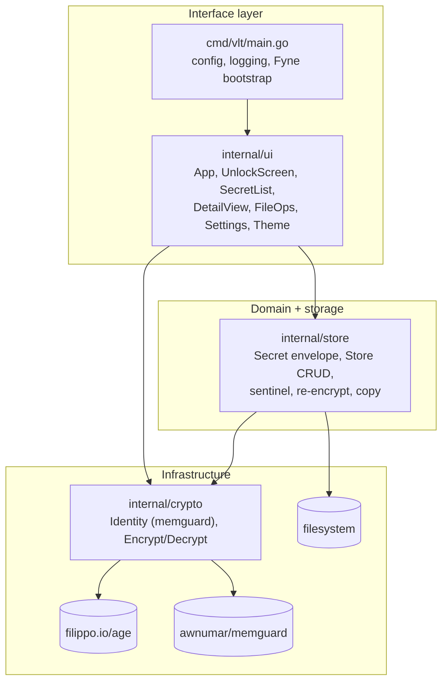
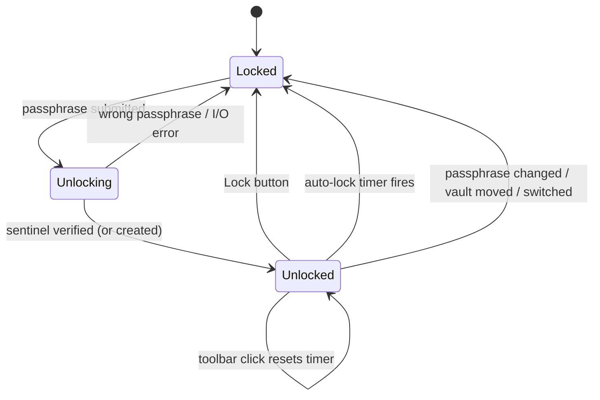

# Architecture Overview

vlt follows the layered layout from the project's `CLAUDE.md`: a thin Fyne interface layer over a storage layer over an age-based crypto layer. Package boundaries are enforced with `internal/`.

## Layers

> [!warning] Layering leak
> `internal/ui` imports `internal/crypto` directly: `App.onUnlock` and the change-passphrase flow in `SettingsScreen` build identities themselves. Ideally the UI talks only to an application-level vault service that owns identity lifecycle. That becomes natural once [[F01 Scrypt-wrapped identity]] lands.

## Packages

| Package | Responsibility | Key files |
|---|---|---|
| `cmd/vlt` | Read env config, set up `slog`, create the Fyne app and window | `main.go` |
| `internal/crypto` | Derive an age scrypt identity from the passphrase; encrypt and decrypt byte slices | `identity.go`, `vault.go` |
| `internal/store` | `Secret` JSON envelope, slugs and groups, directory CRUD, sentinel verification, re-encrypt, copy | `secret.go`, `store.go` |
| `internal/ui` | Lock state machine, screens, clipboard TTL, file import/export, settings | `app.go`, `detail.go`, `list.go`, `fileops.go`, `settings.go` |
| `internal/testutil` | Test identities and secret builders | `fixtures.go` |

## Lock state machine

The auto-lock timer only resets on toolbar clicks. See [[F07 Inactivity-based auto-lock]].

## Dependencies

| Module | Purpose | CGO |
|---|---|---|
| `filippo.io/age` v1.3.1 | File encryption | no |
| `fyne.io/fyne/v2` v2.7.3 | GUI | **yes** (desktop driver uses go-gl/glfw) |
| `github.com/awnumar/memguard` v0.23.0 | Locked memory buffers | no |

Because Fyne's desktop driver needs CGO, the CI cross-build matrix with `CGO_ENABLED=0` can't work. See [[F12 Fix CI pipeline]].

## Related
- [[Unlock Flow]]
- [[Storage Format]]
- [[Security Model]]
