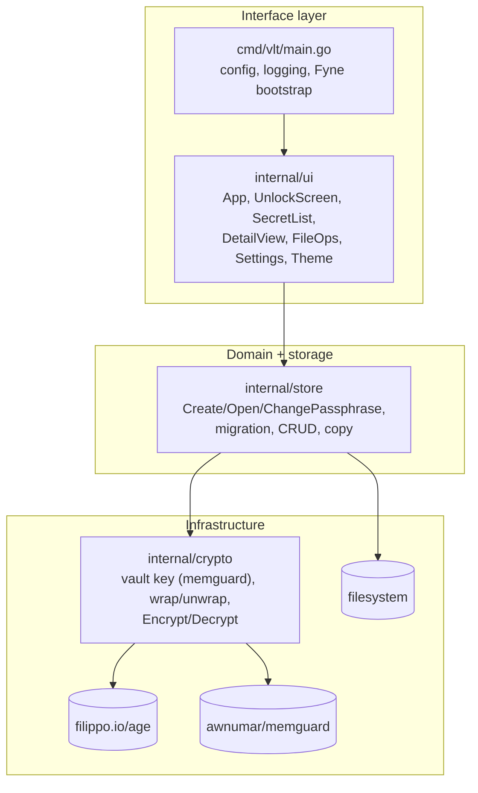

# Architecture Overview

vlt follows the layered layout from the project's `CLAUDE.md`: a thin Fyne interface layer over a storage layer over an age-based crypto layer. Package boundaries are enforced with `internal/`.

## Layers

> [!success] Layering leak resolved
> `internal/ui` no longer imports `internal/crypto`. Since [[F01 Scrypt-wrapped identity]], the UI calls `store.Exists`/`Create`/`Open`/`ChangePassphrase`, and the store owns the vault key's lifecycle.

## Packages

| Package | Responsibility | Key files |
|---|---|---|
| `cmd/vlt` | Read env config, set up `slog`, create the Fyne app and window | `main.go` |
| `internal/crypto` | Generate the X25519 vault key and hold it in memguard; wrap/unwrap it with the passphrase (scrypt); encrypt and decrypt secrets to it | `identity.go`, `vault.go` |
| `internal/store` | `Secret` JSON envelope, slugs and groups, directory CRUD, vault create/open/change-passphrase, format-1 migration, atomic writes, copy | `secret.go`, `store.go`, `vault.go`, `migrate.go`, `atomic.go` |
| `internal/ui` | Lock state machine, screens, background runner, clipboard TTL, file import/export, settings (persisted in Fyne preferences) | `app.go`, `runner.go`, `activity.go`, `clipboard.go`, `config.go`, `create.go`, `unlock.go`, `detail.go`, `list.go`, `fileops.go`, `settings.go` |
| `internal/testutil` | Test identities and secret builders | `fixtures.go` |

## Lock state machine

```mermaid
stateDiagram-v2
    [*] --> Locked
    Locked --> Creating: no vault at path (create screen)
    Creating --> Creating: mismatch / too short
    Creating --> Unlocked: confirmed, vault created
    Locked --> Unlocking: passphrase submitted
    Unlocking --> Locked: wrong passphrase / I/O error
    Unlocking --> Unlocked: vault key unwrapped (or migrated)
    Unlocked --> Locked: Lock button
    Unlocked --> Locked: auto-lock timer fires
    Unlocked --> Locked: passphrase changed / vault moved / switched
    Unlocked --> Unlocked: user input resets timer
```

Widget input (entries, buttons, list selection, sliders), unfocused key presses and dialog answers reset the timer. A warning shows 30 s before locking when the timeout is 60 s or more. See [[F07 Inactivity-based auto-lock]].

## Dependencies

| Module | Purpose | CGO |
|---|---|---|
| `filippo.io/age` v1.3.1 | File encryption | no |
| `fyne.io/fyne/v2` v2.7.3 | GUI | **yes** (desktop driver uses go-gl/glfw) |
| `github.com/awnumar/memguard` v0.23.0 | Locked memory buffers | no |

Because Fyne's desktop driver needs CGO, CI builds natively on Linux, macOS and Windows runners with cgo enabled ([[F12 Fix CI pipeline]]).

## Related
- [[Unlock Flow]]
- [[Storage Format]]
- [[Security Model]]
