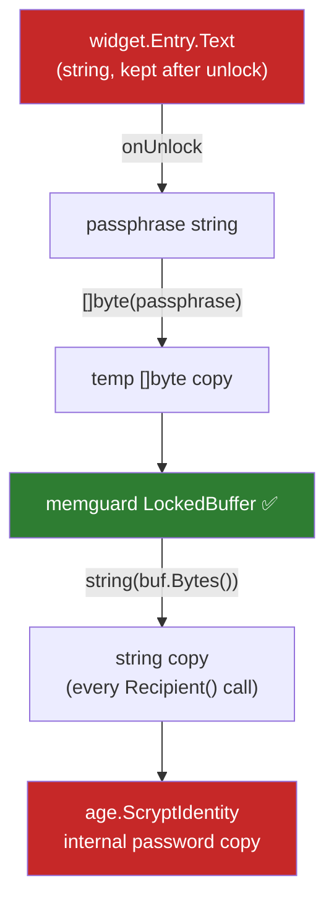

# Security Model

## Assets and threats

| Asset | Threat | Current mitigation | Gap |
|---|---|---|---|
| Vault files at rest | Offline brute force | age scrypt, $N=2^{18}$ | Depends on passphrase strength ([[Passphrase Strength]]) |
| Passphrase in RAM | Memory dump, swap, core file | `memguard.LockedBuffer` | Plain copies exist outside the buffer (below) |
| Decrypted secrets in RAM | Same | none | Held as Go `string`s, kept after lock |
| Clipboard | Other apps, clipboard history | TTL clear | Clears unconditionally; overlapping copies break the TTL ([[F08 Correct clipboard clearing]]) |
| Unattended session | Shoulder surfing | Auto-lock | Timer ignores most activity ([[F07 Inactivity-based auto-lock]]) |
| Vault integrity | Crash mid-write, partial re-encrypt | none | [[F02 Atomic file writes]], [[F01 Scrypt-wrapped identity]] |

## Where the passphrase actually lives

Only the green box is protected. Go strings are immutable and can't be wiped. `Identity.Zero()` destroys the buffer and drops the age pointer, but the age struct's password copy stays on the heap until the garbage collector reclaims it, and nothing ever overwrites it.

> [!warning] Docs overclaim
> `DESIGN.md` says the passphrase is "never stored… in memory beyond the scrypt derivation call". That isn't true today. See [[F11 Memory hygiene and honest docs]].

## Realistic goal

Perfect memory hygiene isn't achievable in Go with a GUI toolkit that hands back `string`s. A reasonable target:

1. Clear the unlock entry right after reading it.
2. On lock, drop every reference to decrypted secrets (`secretList`, `detailView`) and clear the clipboard.
3. After [[F01 Scrypt-wrapped identity]], hold the **X25519 key** (not the passphrase) as the long-lived secret, and discard the passphrase immediately after unwrapping.
4. Document the remaining limits plainly.

## Related
- [[Architecture Overview]]
- [[2026-10-27 Code Review]]
