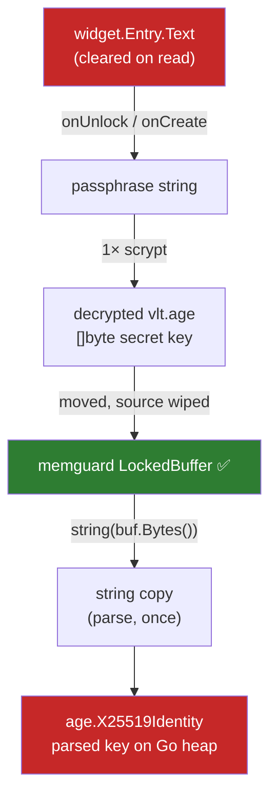

# Security Model

## Assets and threats

| Asset | Threat | Current mitigation | Gap |
|---|---|---|---|
| Vault files at rest | Offline brute force | age scrypt, $N=2^{18}$ | Depends on passphrase strength ([[Passphrase Strength]]) |
| Vault key in RAM | Memory dump, swap, core file | Encoded key in `memguard.LockedBuffer` | Parsed key and string copies on the Go heap (below) |
| Passphrase in RAM | Same | Entries cleared on read; used only to unwrap `vlt.age`, then dropped ([[F11 Memory hygiene and honest docs]]) | Go strings reachable until GC |
| Decrypted secrets in RAM | Same | Emptied and dereferenced on lock; byte buffers vlt owns zeroed ([[F11 Memory hygiene and honest docs]]) | Strings on the heap until GC, not overwritten; library-internal copies |
| Clipboard | Other apps, clipboard history | TTL clear of vlt's own value; cleared on lock ([[F08 Correct clipboard clearing]]) | OS clipboard history or managers may keep a copy |
| Exported file | Other users of the computer | Written to a new 0600 file renamed into place, so an earlier handle or a planted symlink never sees it ([[F36 Private exports]]) | A plaintext copy outside the vault, kept until the user deletes it. Windows, and drives without Unix modes (FAT, exFAT, SMB), rely on the folder's permissions. The save dialog itself empties a symlink's target before vlt writes. Written in place (0600) in a folder the user can't add files to, where a handle opened earlier is not revoked. A crash mid-export can leave a 0600 `.vlt-export-*` temp file |
| Unattended session | Shoulder surfing | Auto-lock on real inactivity, with a 30 s warning ([[F07 Inactivity-based auto-lock]]) | Scrolling and pointer movement don't count as activity |
| Vault on a server | Server operator, network | Secrets and the vault key are age-encrypted before they are sent; OpenSSH authenticates the host (`known_hosts`, batch mode) and encrypts the transport ([[ADR-002 Vaults on a server over the system ssh]]) | The server sees names, sizes, times, `vlt.json` and `vlt.lock` (plain text); can guess passphrases offline against `vlt.age`; can delete files or roll any file back undetected, but not alter a file or swap two undetected ([[F34 Tampered vault files]]). A user ssh config with `StrictHostKeyChecking accept-new` accepts new host keys |
| TOTP secrets | Vault compromise | Stored encrypted like every field ([[F32 TOTP codes]]); a copied code is cleared like any secret | Kept with the password under one passphrase: whoever unlocks the vault has both factors |
| Update check | Network observer, GitHub | Off unless asked for or turned on; one HTTPS GET; nothing downloaded or run; the link is built from a tag that must be `vX.Y.Z`; redirects only to `api.github.com` ([[F29 Check for updates]]) | GitHub and the network learn the user's IP address and that they run vlt |
| Two copies editing one vault | Lost edit | `vlt.lock` warns before a second unlock ([[F26 Vault lock file]]); creates never overwrite | Same-secret edits are last-writer-wins; two computers with the same host name count as one; a lock that can't be read (a connection that stays down, a disk error) is skipped, and the vault opens without a warning ([[F37 Lock read errors]]) |
| Vault integrity | Crash mid-write, partial re-encrypt | Per-file atomic writes ([[F02 Atomic file writes]]); passphrase change rewrites one file and migration is resumable ([[F01 Scrypt-wrapped identity]]) | Concurrent writers other than migration are not coordinated |
| Tampered or swapped file | Hostile server, shared folder, bad disk | age authenticates each file; a secret must be stored at the path its name and group give, and must have a name and a known type ([[F34 Tampered vault files]]) | The list leaves such a file out with only a log warning; the user isn't told |

## Where key material lives (after F01)

The passphrase is no longer held for the session. It is used once to unwrap `vlt.age` and then dropped. The long-lived secret is the vault key. Its encoded form is in the green buffer, but age's parsed `X25519Identity` (and one transient string copy) sit on the Go heap. `Identity.Zero()` destroys the buffer and drops the pointer, but it cannot wipe the heap copy.

## Realistic goal

Perfect memory hygiene isn't achievable in Go with a GUI toolkit that hands back `string`s. A reasonable target:

1. ✅ Clear the unlock entry right after reading it (F11).
2. ✅ On lock, empty and drop every reference to decrypted secrets (F11). The clipboard is cleared on lock (F08).
3. ✅ Done in [[F01 Scrypt-wrapped identity]]: the long-lived secret is the X25519 vault key, and the passphrase is used only to unwrap it.
4. ✅ Document the remaining limits plainly (F11).

## Related
- [[Architecture Overview]]
- [[2026-10-27 Code Review]]
