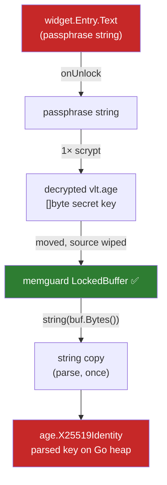

# Security Model

## Assets and threats

| Asset | Threat | Current mitigation | Gap |
|---|---|---|---|
| Vault files at rest | Offline brute force | age scrypt, $N=2^{18}$ | Depends on passphrase strength ([[Passphrase Strength]]) |
| Vault key in RAM | Memory dump, swap, core file | Encoded key in `memguard.LockedBuffer` | Parsed key and string copies on the Go heap (below) |
| Passphrase in RAM | Same | Used only to unwrap `vlt.age`, then dropped | Lives in Fyne entry text and Go strings ([[F11 Memory hygiene and honest docs]]) |
| Decrypted secrets in RAM | Same | none | Held as Go `string`s, kept after lock |
| Clipboard | Other apps, clipboard history | TTL clear | Clears unconditionally; overlapping copies break the TTL ([[F08 Correct clipboard clearing]]) |
| Unattended session | Shoulder surfing | Auto-lock | Timer ignores most activity ([[F07 Inactivity-based auto-lock]]) |
| Vault integrity | Crash mid-write, partial re-encrypt | Per-file atomic writes ([[F02 Atomic file writes]]); passphrase change rewrites one file and migration is resumable ([[F01 Scrypt-wrapped identity]]) | Concurrent writers other than migration are not coordinated |

## Where key material lives (after F01)

The passphrase is no longer held for the session. It is used once to unwrap `vlt.age` and then dropped. The long-lived secret is the vault key. Its encoded form is in the green buffer, but age's parsed `X25519Identity` (and one transient string copy) sit on the Go heap. `Identity.Zero()` destroys the buffer and drops the pointer, but it cannot wipe the heap copy.

## Realistic goal

Perfect memory hygiene isn't achievable in Go with a GUI toolkit that hands back `string`s. A reasonable target:

1. Clear the unlock entry right after reading it.
2. On lock, drop every reference to decrypted secrets (`secretList`, `detailView`) and clear the clipboard.
3. ✅ Done in [[F01 Scrypt-wrapped identity]]: the long-lived secret is the X25519 vault key, and the passphrase is used only to unwrap it.
4. Document the remaining limits plainly.

## Related
- [[Architecture Overview]]
- [[2026-10-27 Code Review]]
