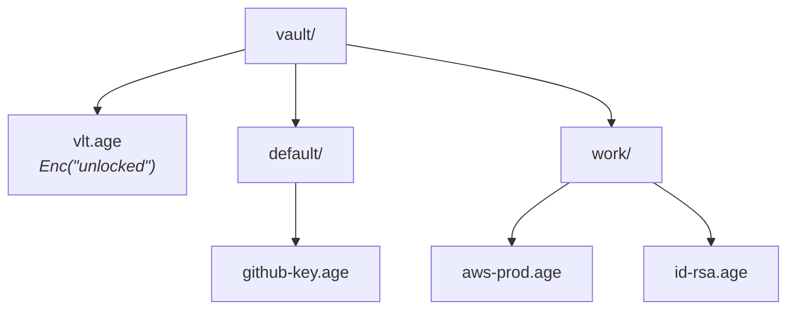

# Storage Format

## Directory layout



- Default location: `~/Library/Application Support/vlt/vault` (macOS), `%APPDATA%\vlt\vault` (Windows), `~/.local/share/vlt/vault` (others). You can override it with `VLT_VAULT_DIR`.
- Permissions: directories `0700`, files `0600`.
- Path: `vault/<NormalizeGroup(group)>/<Slugify(name)>.age`.

## Slug function

$$
\operatorname{slug}(s) = \operatorname{trim}_{\texttt{-}}\Big(\operatorname{replace}_{[^{a\text{-}z0\text{-}9}]^{+}\,\to\,\texttt{-}}\big(\operatorname{lower}(\operatorname{trim}(s))\big)\Big)
$$

`slug` is **not injective**. Many names map to the same file:

| Name | Slug |
|---|---|
| `GitHub Key` | `github-key` |
| `github-key` | `github-key` |
| `GitHub_Key!` | `github-key` |
| `日本` / `!!!` | *(empty)* → `.age` |

That makes collisions deterministic, not just possible. See [[F03 Prevent silent overwrites]].

> [!tip] Safety property
> Because both group and name pass through `slug`, which only emits `[a-z0-9-]`, path traversal (`../`) is impossible. Keep that property in whatever replaces it.

## Secret envelope

Each `.age` file decrypts to an indented JSON document (`internal/store/secret.go`):

```jsonc
{
  "version": 1,
  "type": "password | record | file",
  "name": "GitHub Key",
  "group": "work",
  "created_at": "2026-10-27T09:00:00Z",
  "modified_at": "2026-10-27T09:00:00Z",
  "tags": ["dev"],
  "notes": "",
  "value": "...",            // password type; base64 body for file type
  "username": "", "password": "", "url": "", "totp_secret": "",
  "original_filename": "", "mime_type": "", "encoding": "base64"
}
```

File secrets are base64-encoded inside `value`, so a 10 MiB import becomes about $\tfrac{4}{3}\times 10 \approx 13.3$ MiB of JSON. `List()` decrypts **every** file, including large file secrets, just to show names. An unencrypted-name index or a separate encrypted metadata file would avoid that.

## Write semantics

All writes use `os.WriteFile`, which truncates the file and then writes. A crash between the two leaves an empty or partial file. See [[F02 Atomic file writes]].

## Related
- [[Architecture Overview]]
- [[Unlock Flow]]
