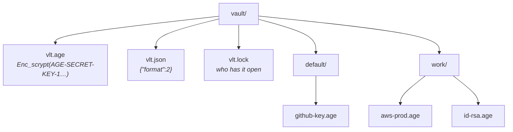
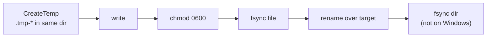

# Storage Format

## Directory layout



- Default location: `~/Library/Application Support/vlt/vault` (macOS), `%APPDATA%\vlt\vault` (Windows), and `$XDG_DATA_HOME/vlt/vault` on other systems, or `~/.local/share/vlt/vault` when `XDG_DATA_HOME` is unset or relative. A vault already in `~/.local/share/vlt/vault` is kept when the XDG location holds none. You can override it with `VLT_VAULT_DIR`.
- Or on an SSH server: `[user@]host:path` or `ssh://[user@]host[:port]/path`, the same layout read and written over SFTP ([[ADR-002 Vaults on a server over the system ssh]]).
- Permissions: directories `0700`, files `0600` (on a server too: set explicitly, since SFTP applies the server's umask).
- `vlt.lock` is JSON `{host, user, pid, since, token}`, written when a copy of vlt unlocks the vault and removed when it locks or quits; a crashed copy leaves it, and the next unlock on that computer takes it over ([[F26 Vault lock file]]). It is not part of the vault: `CopyTo` skips it.
- On a server, `.vlt-tmp/` (0700) holds writes in progress. Directory walks skip dot-folders, which can never be groups (group directories are slugs).
- Path: `vault/<NormalizeGroup(group)>/<Slugify(name)>.age`.
- The envelope's `group` is the name as typed and trimmed (`GroupLabel`); only the directory is slugified. Labels that differ only in case or punctuation (`Personal Finance`, `personal-finance`) share one directory. The UI lists one label per directory and files new secrets under the existing spelling.
- A subdirectory holding `vlt.json` or `vlt.migrating.age` is a nested vault, not a group: `Exists`, `Open` and migration ignore its files. Other nested vaults can't be told apart by layout (a secret named "vlt" is stored in its group as `vlt.age`), so `Open` accepts a passphrase only if a probed file decrypts to a secret's JSON envelope, and migration never re-encrypts a file that decrypts to anything else (another vault's sentinel or key).
- Secrets are encrypted to the vault's X25519 key. `vlt.age` holds that key, encrypted to the passphrase (scrypt). `vlt.json` records the format version. `vlt.migrating.age` exists only while a format-1 vault is being migrated.

## Slug function

$$
\operatorname{slug}(s) = \operatorname{trim}_{\texttt{-}}\Big(\operatorname{replace}_{[^{a\text{-}z0\text{-}9}]^{+}\,\to\,\texttt{-}}\big(\operatorname{lower}(\operatorname{trim}(s))\big)\Big)
$$

`slug` is **not injective**. Many names map to the same file:

| Name | Slug |
|---|---|
| `GitHub Key` | `github-key` |
| `github-key` | `github-key` |
| `GitHub_Key!` | `github-key` |
| `日本` / `!!!` | *(empty)*: rejected by `NewSecretName` |

Because `slug` isn't injective, `Create` writes exclusively (temp file + `link`) and returns `ErrSecretExists` if the file exists. `Update` requires the stored name to match exactly. Slugs longer than 251 bytes are rejected, so `<slug>.age` fits in a 255-byte filename. See [[F03 Prevent silent overwrites]].

> [!tip] Safety property
> Because the path uses only the slugs of group and name, which only emits `[a-z0-9-]`, path traversal (`../`) is impossible. Keep that property in whatever replaces it.

## Secret envelope

Each `.age` file decrypts to an indented JSON document (`internal/store/secret.go`):

```jsonc
{
  "version": 1,
  "type": "password | record | file",
  "name": "GitHub Key",
  "group": "work",
  "created_at": "2026-10-27T09:00:00Z",
  "modified_at": "2026-10-27T09:00:00Z",
  "tags": ["dev"],
  "notes": "",
  "value": "...",            // password type; base64 body for file type
  "username": "", "password": "", "url": "", "totp_secret": "",
  "original_filename": "", "mime_type": "", "encoding": "base64"
}
```

File secrets are base64-encoded inside `value`, so a 10 MiB import becomes about $\tfrac{4}{3}\times 10 \approx 13.3$ MiB of JSON. `List()` decrypts **every** file, including large file secrets, just to show names. An unencrypted-name index or a separate encrypted metadata file would avoid that.

## Write semantics

Every write goes through the storage interface `vaultFS` ([[F24 Storage abstraction]]). Locally that is `writeFileAtomic` (`internal/store/atomic.go`), added by [[F02 Atomic file writes]]:



- A crash leaves either the old file or the new one, never a truncated file.
- New group directories are fsynced into their parent (`mkdirAllSynced`).
- Leftover `.tmp-*` files never end in `.age`, so `List` and `CopyTo` skip them.
- On a server ([[F25 SFTP backend and server locations]]), a write goes through these steps:
  1. Create a `.tmp-*` file exclusively in the private `.vlt-tmp/` folder, so no other user can open it before step 2.
  2. `chmod 0600`, before any data is written.
  3. Write it.
  4. `fsync`, when the server offers `fsync@openssh.com`.
  5. `posix-rename@openssh.com` over the target.

  Exclusive creates use `hardlink@openssh.com` instead of the rename (or an `O_EXCL` create where the file system cannot link). SFTP cannot fsync a directory, so a server crash can undo the last rename, leaving the previous version, never a partial file.
- Atomicity is **per file**. Since [[F01 Scrypt-wrapped identity]], passphrase change rewrites only `vlt.age`. Format-1 migration stages the new key in `vlt.migrating.age` (created exclusively), re-encrypts secrets one atomic write at a time, swaps `vlt.age` only after every secret is done, then writes `vlt.json`.

## Related
- [[Architecture Overview]]
- [[Unlock Flow]]
