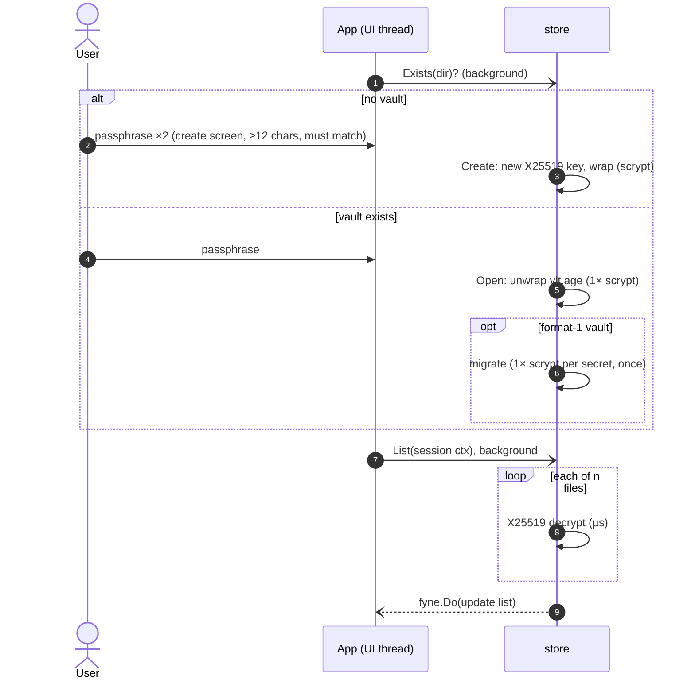

# Unlock Flow

## Current flow (after F10)

`App.showUnlockScreen` checks `store.Exists` first and shows either the unlock screen or the create-vault screen. `onUnlock` (existing vault) and `onCreate` (new vault) run in the background via `runner.background`. Their results return through `fyne.Do`, and a result for a screen that has since been replaced is discarded.

Since [[F01 Scrypt-wrapped identity]], unlock costs exactly one scrypt (measured by `TestOpen_RunsExactlyOneScrypt`), and listing is fast. See [[Scrypt Cost Model]].

> [!success] Off the UI thread since F10
> The unlock and create screens show a progress bar while scrypt runs. After unlock, all vault work uses a runner bound to the session context, so locking cancels it and drops late results. See [[F10 Keep vault IO off the UI goroutine]].

## Related
- [[ADR-001 Scrypt-wrapped X25519 identity]]
- [[F04 Confirm passphrase on vault creation]]
- [[F10 Keep vault IO off the UI goroutine]]
