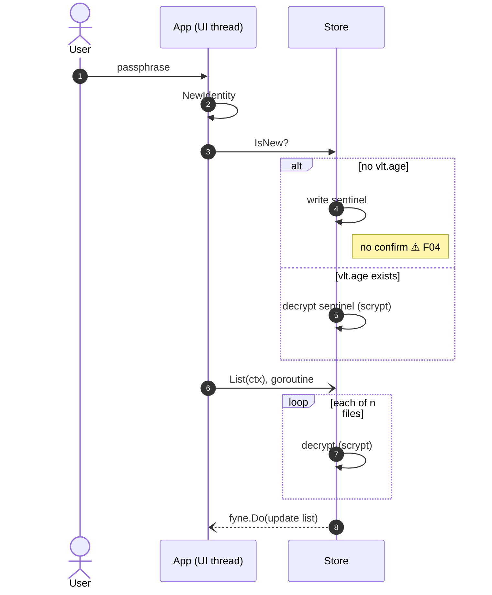
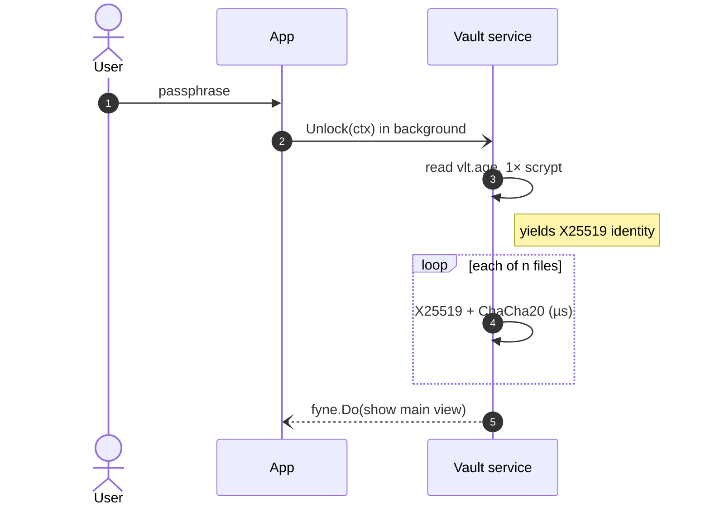

# Unlock Flow

## Current flow

`App.onUnlock` (`internal/ui/app.go:75`) runs on the Fyne main goroutine while holding `App.mu`.

> [!danger] The loop is the problem
> Every decrypt in the loop runs a full scrypt derivation (about 256 MiB of memory, order of a second). Opening the vault costs $n$ scrypts, and so does every list refresh after a save, which runs on the **UI goroutine**. See [[Scrypt Cost Model]].

## Proposed flow (after [[F01 Scrypt-wrapped identity]])

There's exactly one scrypt per unlock. The sentinel is replaced by the wrapped key file, so a wrong passphrase still fails fast on that one file.

## Related
- [[ADR-001 Scrypt-wrapped X25519 identity]]
- [[F04 Confirm passphrase on vault creation]]
- [[F10 Keep vault IO off the UI goroutine]]
