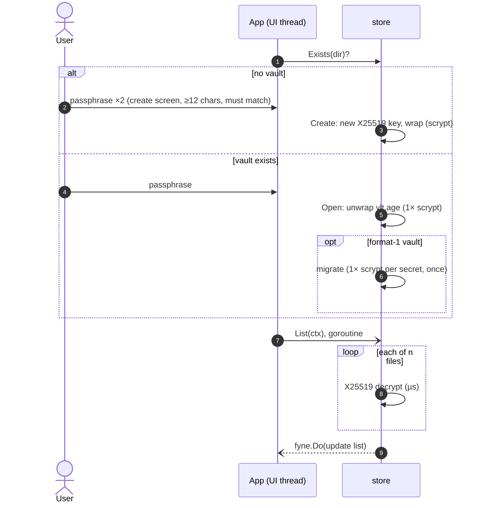
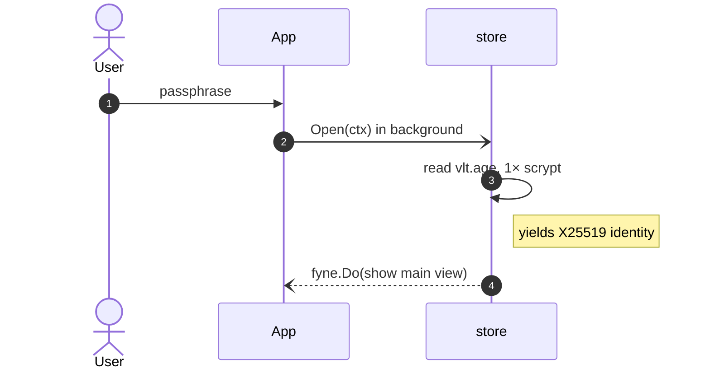

# Unlock Flow

## Current flow (after F01)

`App.showUnlockScreen` checks `store.Exists` first and shows either the unlock screen or the create-vault screen. `onUnlock` (existing vault) and `onCreate` (new vault) run on the Fyne main goroutine while holding `App.mu`.

Since [[F01 Scrypt-wrapped identity]], unlock costs exactly one scrypt (measured by `TestOpen_RunsExactlyOneScrypt`), and listing is fast. See [[Scrypt Cost Model]].

> [!warning] Still on the UI thread
> `Open` (one scrypt, or a whole migration on first unlock of a format-1 vault) still runs on the main goroutine, so the window freezes for about a second, or longer during migration. Moving it to the background is [[F10 Keep vault IO off the UI goroutine]].

## Target flow (after F10)

## Related
- [[ADR-001 Scrypt-wrapped X25519 identity]]
- [[F04 Confirm passphrase on vault creation]]
- [[F10 Keep vault IO off the UI goroutine]]
