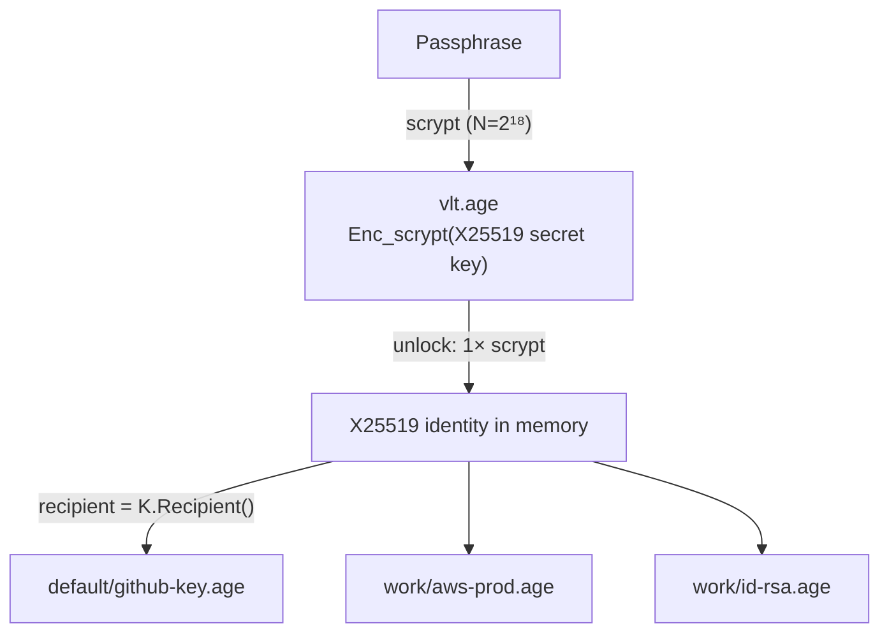

# ADR-001: Scrypt-wrapped X25519 identity

## Status
**Proposed**, raised by the [[2026-10-27 Code Review]] and implemented by [[F01 Scrypt-wrapped identity]].

## Context

Every secret file is currently encrypted to an `age.ScryptRecipient` derived from the passphrase. Each decrypt therefore runs a full scrypt derivation (256 MiB, roughly 0.5–1 s). Unlock, list refresh, and passphrase change all cost $O(n)$ scrypts ([[Scrypt Cost Model]]). Changing the passphrase has to rewrite every file, which can't be done atomically. That's the source of review finding #2.

## Decision

Introduce a **vault key**: a random age X25519 identity generated once when the vault is created.

- `vlt.age` holds the X25519 secret key (`AGE-SECRET-KEY-1…`), encrypted to the passphrase with an age scrypt recipient. It replaces the `"unlocked"` sentinel, and a failed decrypt still means a wrong passphrase.
- Every secret file is encrypted to the X25519 recipient.
- **Changing the passphrase** decrypts `vlt.age` and re-encrypts it to the new passphrase, using a temp file plus rename. One file, atomic.
- **Moving or copying a vault** is unchanged: the directory stays self-contained and portable.

### Format versioning
Add a small plaintext header line or a `vlt.json` with `{"format": 2}` so future migrations can detect the layout. A v1 vault (sentinel present, decrypts to `"unlocked"`) is migrated on first unlock: generate the key, re-encrypt every file to it using atomic writes, then replace the sentinel last.

## Consequences

**Positive**
- Unlock costs $t_s + n\,t_x$ instead of $(n+1)\,t_s$: about 0.75 s regardless of size.
- Changing the passphrase is a single atomic rewrite with no partial-failure states.
- Raising the scrypt work factor becomes affordable.
- The long-lived in-memory secret is the X25519 key, not the passphrase.

**Negative**
- Anyone who obtains the X25519 key can read every file, but the same is true of the passphrase today.
- A one-time migration path for existing v1 vaults is needed.
- `vlt.age` becomes a single point of failure. A backup or export of it should be recommended in the docs.

**Neutral**
- Offline brute-force resistance is unchanged ([[Passphrase Strength]]).

## Alternatives considered

| Option | Why not |
|---|---|
| Cache the derived scrypt key | age doesn't expose the file key or scrypt output; it would mean forking age |
| Lower the scrypt work factor | Weakens offline resistance for every file |
| One big encrypted file | Loses per-secret files and merge-friendliness; still rewrites everything per save |
| OS keychain | Breaks portability and OpenBSD support (a stated design goal) |
