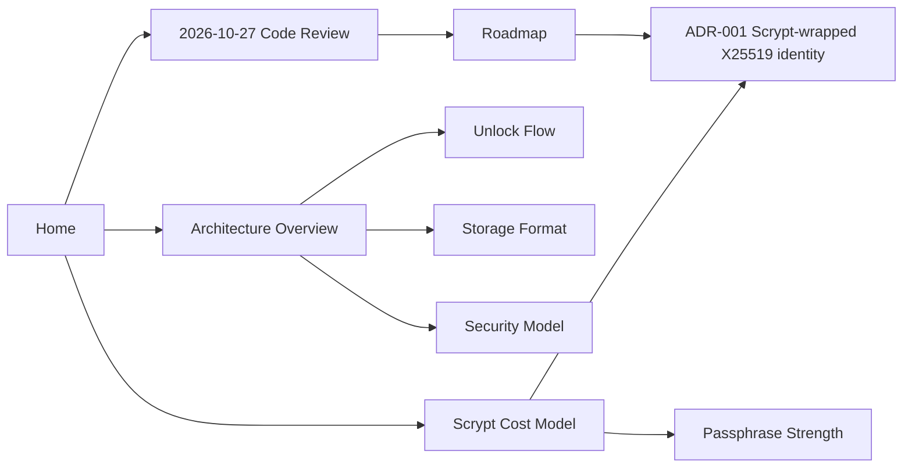

# vlt Knowledge Base

**vlt** is a cross-platform desktop secret manager written in Go with a [Fyne](https://fyne.io) GUI. Secrets are stored as individual [age](https://age-encryption.org)-encrypted files in a plain directory, unlocked with a single passphrase.

This vault is the working notebook for the project: architecture notes, the maths behind the crypto choices, review findings, design decisions, and the fix roadmap.

> [!abstract] Current state (2026-10-27)
> The code is cleanly layered and the store tests pass, but the [[2026-10-27 Code Review|latest review]] found a scaling flaw in the key design and several data-loss paths. Work is tracked in the [[Roadmap]].

## Map of content

### Architecture
- [[Architecture Overview]]: layers, packages, and dependencies
- [[Unlock Flow]]: what happens between the passphrase prompt and the secret list
- [[Storage Format]]: the on-disk layout and the JSON envelope
- [[Security Model]]: what memory protection actually provides today

### Maths
- [[Scrypt Cost Model]]: why per-file scrypt doesn't scale, with numbers
- [[Passphrase Strength]]: entropy and brute-force cost

### Reviews and decisions
- [[2026-10-27 Code Review]]
- [[ADR-001 Scrypt-wrapped X25519 identity]]

### Roadmap
- [[Roadmap]]: phased plan
- [[Roadmap.base|Fix tracker]]: live table of every fix note

![[Roadmap.base#Open by phase]]

## Conventions
- Fix notes live in `Roadmap/Fixes/` and use the [[Fix Template]]. Each one has an `F##` alias, so `[[F01]]` resolves.
- Decision records live in `Decisions/` and use the [[Decision Template]].
- Diagrams are Mermaid; maths is LaTeX (`$inline$`, `$$block$$`).
- Code references use repo-relative paths, e.g. `internal/store/store.go:285`.
