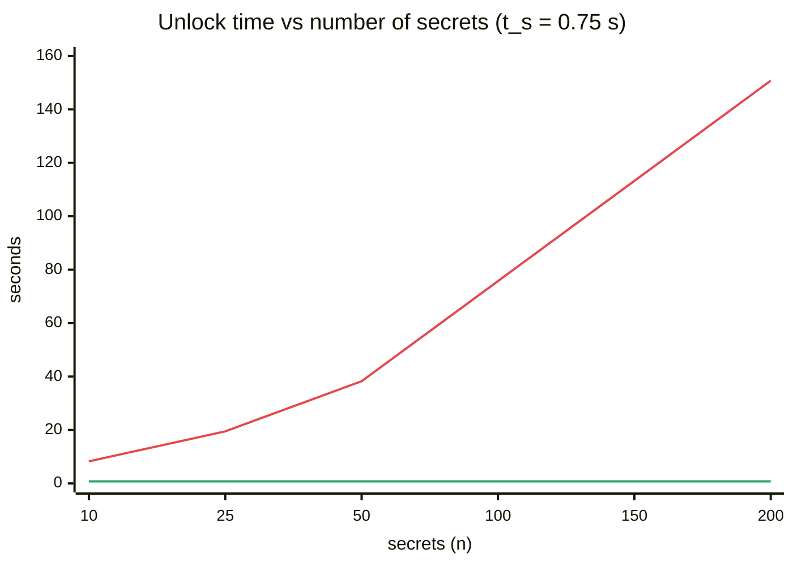

# Scrypt Cost Model

Why encrypting every secret to an age **scrypt recipient** made vlt slower with every secret added, and what the [[ADR-001 Scrypt-wrapped X25519 identity|vault-key design]] changed. Format 2 shipped in [[F01 Scrypt-wrapped identity]].

## Scrypt memory per derivation

scrypt's memory use is

$$
M = 128 \cdot r \cdot N \ \text{bytes}
$$

age uses $r = 8$ and a default work factor $\log_2 N = 18$:

$$
M = 128 \cdot 8 \cdot 2^{18} = 2^{7} \cdot 2^{3} \cdot 2^{18} = 2^{28}\ \text{B} = 256\ \text{MiB}
$$

Each `crypto.Decrypt` call allocates and fills about 256 MiB. Running $k$ of them in parallel would need $256k$ MiB, so they can't be usefully parallelised on a desktop.

## Time model

Let

- $n$ = number of secrets in the vault
- $t_s$ = time for one scrypt derivation ($\approx 0.5$–$1\,\text{s}$ on an Apple M-series; the store tests take 1–3 s each)
- $t_x$ = time for an X25519 unwrap plus ChaCha20-Poly1305 of a small payload ($\sim 10^{-4}\,\text{s}$)

### Format 1, before F01 (one scrypt per file)

| Operation | Cost |
|---|---|
| Unlock (verify sentinel + list) | $T_\text{unlock} = (n+1)\,t_s$ |
| Save one secret (encrypt + list refresh) | $T_\text{save} = t_s + n\,t_s = (n+1)\,t_s$ |
| Change passphrase (list + re-encrypt all) | $T_\text{rekey} = 2n\,t_s$ |

The save cost lands **on the UI goroutine**, because `onSave` → `SecretList.Refresh` runs synchronously.

### Format 2, current (scrypt wraps one X25519 key)

| Operation | Cost |
|---|---|
| Unlock | $T'_\text{unlock} = t_s + n\,t_x$ |
| Save one secret | $T'_\text{save} \approx (n+1)\,t_x$ (encrypt + list refresh) |
| Change passphrase | $T'_\text{rekey} = 2\,t_s$ (rewrap one file) |

### Speed-up

$$
S(n) = \frac{T_\text{unlock}}{T'_\text{unlock}} = \frac{(n+1)\,t_s}{t_s + n\,t_x}
\;\xrightarrow{\;t_x \ll t_s\;}\; n+1 \quad\text{for } n \ll t_s/t_x \approx 10^{4}
$$

## Worked numbers ($t_s = 0.75\,\text{s}$, $t_x = 0.1\,\text{ms}$)

| $n$ | Unlock, format 1 | Unlock, format 2 | Save, format 1 (UI frozen) |
|---:|---:|---:|---:|
| 10 | 8.3 s | 0.75 s | 8.3 s |
| 50 | 38 s | 0.76 s | 38 s |
| 200 | 2.5 min | 0.77 s | 2.5 min |

■ format 1 (before F01) $(n+1)\,t_s$ · ■ format 2 (current) $t_s + n\,t_x$

> [!note] Security isn't weakened
> An attacker with the vault directory still has to break one scrypt derivation (on `vlt.age`) per passphrase guess, which is exactly the cost they face today. The per-file scrypt adds no security, because every file uses the same passphrase. See [[Passphrase Strength]].

## Related
- [[F01 Scrypt-wrapped identity]]
- [[F10 Keep vault IO off the UI goroutine]]
- [[Unlock Flow]]
