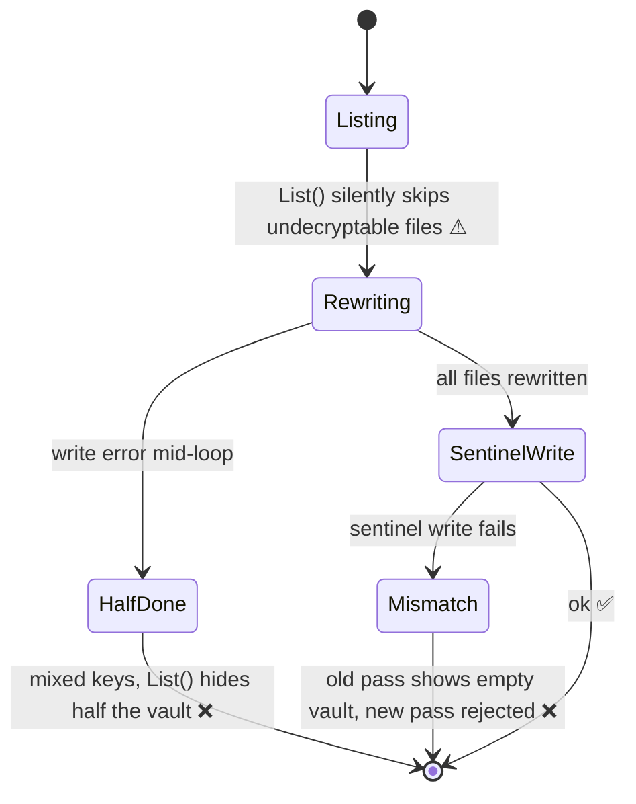

# F01: Scrypt-wrapped identity

Implements [[ADR-001 Scrypt-wrapped X25519 identity]].

## Problem
Every secret is encrypted to an `age.ScryptRecipient` (`internal/crypto/vault.go:13`), so every decrypt runs scrypt ($M = 256$ MiB). `Store.List` (`internal/store/store.go:210`) decrypts every file, so unlock and every list refresh cost $(n+1)\,t_s$. See [[Scrypt Cost Model]].

Changing the passphrase (`Store.ReEncryptAll`, `store.go:285`) has several failure modes:

`ReEncryptAll`'s doc comment says the old identity is zeroed; it isn't, and the new identity is never tracked by `App`, so it's never zeroed either.

## Impact
- A 50-secret vault takes about 40 s to unlock, and the window freezes for about as long after each save.
- Changing the passphrase can permanently strand secrets.

## Fix (as shipped)
1. `crypto`:
   - `GenerateIdentity`, `ParseIdentity`, `WrapIdentity(pass, id, workFactor)`, `UnwrapIdentity`, and `DecryptWithPassphrase` (legacy files only).
   - `Identity` holds the encoded X25519 key in a `memguard.LockedBuffer`, plus the parsed key (best-effort; see [[F11 Memory hygiene and honest docs]]).
2. `store`:
   - `Exists`, `Create`, `Open(ctx, …)`, `ChangePassphrase` (rewraps only `vlt.age`, atomically), and `Close`.
   - `WithWorkFactor` option (tests use 2^10).
   - `ReEncryptAll`, the sentinel helpers, `Verify` and `IsNew` were deleted.
3. Format marker `vlt.json` → `{"format":2}`. `Open` rejects newer formats and restores a missing marker.
4. Format-1 migration (`migrate.go`), in order:
   - Stage the wrapped key in `vlt.migrating.age`, created exclusively, so a second instance joins the migration instead of replacing the key.
   - Re-encrypt secrets one atomic write at a time, skipping files already migrated.
   - Swap `vlt.age`, write the marker, then remove the staging file.
   - Undecryptable files are left untouched and reported in a dialog.
5. Safety guards found by verification:
   - A directory of secrets with no `vlt.age` (moved by pre-b2df715 builds) counts as a vault. It is migrated only if the passphrase decrypts one of its secrets.
   - `Create` and `CopyTo` refuse directories that already hold a vault or secrets.
   - A format-2 vault missing `vlt.age` reports `ErrKeyMissing`.

> [!note] Deviation from the original plan
> The plan said an interrupted migration should leave a vault that "still opens as v1". The shipped design **resumes forward** instead. The new key is staged durably before any secret is touched, so every state is recoverable by this build. An older build would not see secrets already re-encrypted.

## Acceptance criteria
- [x] Unlocking a 100-secret vault runs exactly one scrypt: `TestOpen_RunsExactlyOneScrypt` (runtime counter) and `TestStore_Unlock_RunsExactlyOneScrypt` (only `vlt.age` carries a scrypt stanza)
- [x] `ChangePassphrase` touches only `vlt.age`; a failed write leaves the old passphrase working: `TestStore_ChangePassphrase_RewritesOnlyKeyFile`, `_FailedWriteKeepsOldPassphrase`, `_RejectsWrongCurrent`, `_RejectsForeignKeyFile`
- [x] A v1 vault migrates to v2, and an interrupted migration resumes on next unlock with no secret becoming unreadable: `TestStore_Open_MigratesLegacyVault`, `TestMigration_ResumesAfterCrashMidway`, `_ResumesAfterKeySwapBeforeMarker`, `TestStore_Open_CancelledMigrationCanResume`, `TestBeginMigration_JoinsMigrationStartedElsewhere`
- [x] Wrong passphrase still returns `ErrWrongPassphrase` (format 1 and 2), and a corrupt `vlt.age` does not
- [x] README and DESIGN describe the vault key, migration, and the limits of memguard

## Outcome
Shipped on `fix/review-roadmap` after independent code, docs, and tooling verification. Test suite (race) went from about 24 s to about 4 s once tests use a low scrypt work factor. Peak test memory dropped from 16.6 GB to a few hundred MB.

## Related
- [[Unlock Flow]] · [[Storage Format]] · [[F10 Keep vault IO off the UI goroutine]] · [[F11 Memory hygiene and honest docs]]
