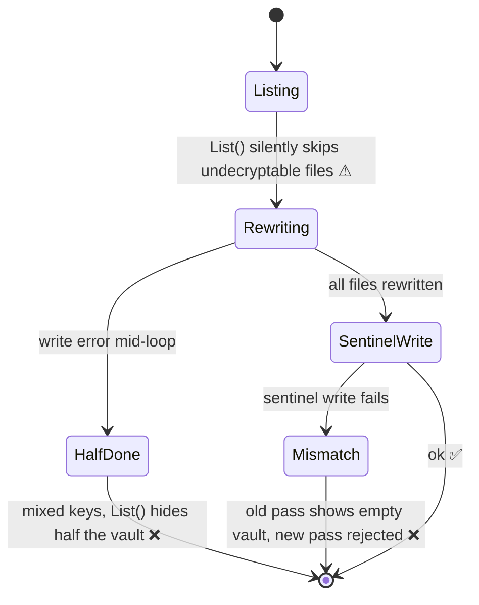

# F01: Scrypt-wrapped identity

Implements [[ADR-001 Scrypt-wrapped X25519 identity]].

## Problem
Every secret is encrypted to an `age.ScryptRecipient` (`internal/crypto/vault.go:13`), so every decrypt runs scrypt ($M = 256$ MiB). `Store.List` (`internal/store/store.go:210`) decrypts every file, so unlock and every list refresh cost $(n+1)\,t_s$. See [[Scrypt Cost Model]].

Changing the passphrase (`Store.ReEncryptAll`, `store.go:285`) has several failure modes:

`ReEncryptAll`'s doc comment says the old identity is zeroed; it isn't, and the new identity is never tracked by `App`, so it's never zeroed either.

## Impact
- A 50-secret vault takes about 40 s to unlock, and the window freezes for about as long after each save.
- Changing the passphrase can permanently strand secrets.

## Fix
1. `crypto`: add `GenerateVaultKey() (*age.X25519Identity, error)`, plus `WrapKey(pass, key)` and `UnwrapKey(pass, blob)` using a scrypt recipient.
2. `crypto.Identity` holds the **X25519 identity** (its secret-key string in a `memguard.LockedBuffer`) instead of the passphrase.
3. `store`:
   - `Create(pass)` writes the wrapped key to `vlt.age`.
   - `Open(pass)` unwraps it.
   - `ChangePassphrase(old, new)` rewraps `vlt.age` atomically ([[F02 Atomic file writes]]).
   - Delete `ReEncryptAll` and `CreateSentinel`/`RecreateSentinel`.
4. Write a format marker (`vlt.json` → `{"format": 2}`).
5. v1 migration: on unlock of a v1 vault, generate a key, re-encrypt each file to it with atomic writes, write `vlt.age` (wrapped key) **last**, then the format marker. If anything fails, abort without touching the sentinel.

## Acceptance criteria
- [ ] Unlocking a 100-secret vault runs exactly one scrypt (assert via a counting test hook or benchmark)
- [ ] `ChangePassphrase` touches only `vlt.age`; a failed write leaves the old passphrase working
- [ ] A v1 vault migrates to v2; an interrupted migration leaves a vault that still opens as v1
- [ ] Wrong passphrase still returns `ErrWrongPassphrase`
- [ ] README and DESIGN updated to describe the vault key

## Related
- [[Unlock Flow]] · [[Storage Format]] · [[F10 Keep vault IO off the UI goroutine]] · [[F11 Memory hygiene and honest docs]]
