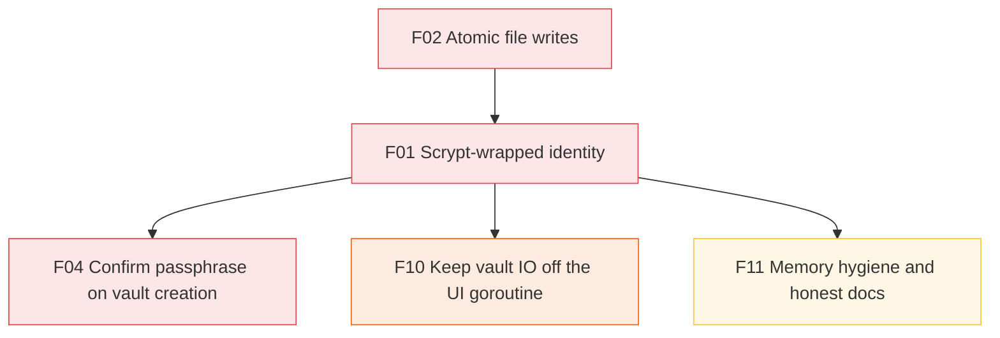
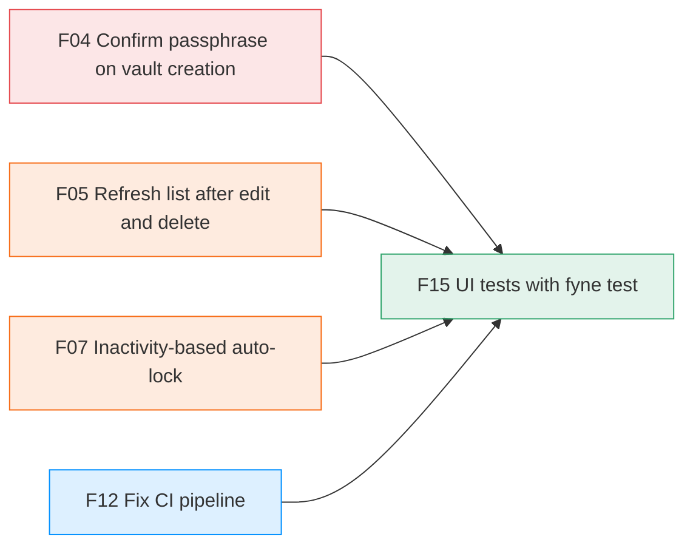
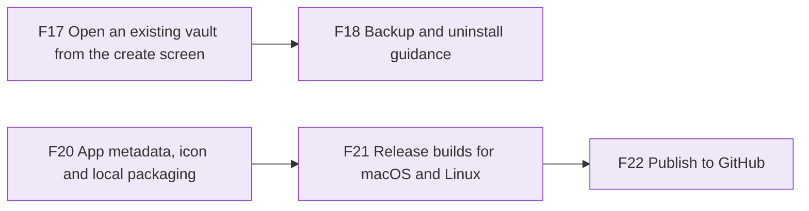

# Roadmap

The fix plan from the [[2026-10-27 Code Review]], in five phases, plus a sixth release phase. Earlier phases unblock or de-risk later ones. Each fix is its own note in `Roadmap/Fixes/`, and its `status` property drives the tracker below.

> [!important] Why storage goes first
> [[F01 Scrypt-wrapped identity]] changes the on-disk format. Doing it before anyone has real vaults avoids writing a migration under pressure, and it removes the root cause of two critical findings.

## Dependency graph

**Storage chain.** Everything that depends on the new key design.

**UI test gate.** The behaviour these fixes add is what [[F15 UI tests with fyne test|F15]] tests.

Phase colours: ■ 1 storage · ■ 2 UI · ■ 3 memory · ■ 4 CI · ■ 5 tests · ■ 6 release. An arrow `A → B` means *do A before B*. Click a node to open its note.

The other fixes have no ordering constraints and can be picked up at any point within their phase: [[F03 Prevent silent overwrites]], [[F06 Persist settings]], [[F08 Correct clipboard clearing]], [[F09 Fail import on read errors]], [[F13 Project hygiene]], [[F14 Remove reinvented stdlib and dead code]].

## Phases

### Phase 1: Storage & data safety
Goal: no operation can lose or strand a secret, and unlock costs one scrypt.
- [[F02 Atomic file writes]]: prerequisite for a safe migration
- [[F01 Scrypt-wrapped identity]]: see [[ADR-001 Scrypt-wrapped X25519 identity|ADR-001]]
- [[F03 Prevent silent overwrites]]
- [[F04 Confirm passphrase on vault creation]]

### Phase 2: UI correctness
Goal: the UI never freezes, never shows stale data, and never discards edits.
- [[F10 Keep vault IO off the UI goroutine]]
- [[F05 Refresh list after edit and delete]]
- [[F07 Inactivity-based auto-lock]]
- [[F08 Correct clipboard clearing]]
- [[F09 Fail import on read errors]]
- [[F06 Persist settings]]

### Phase 3: Memory hygiene
- [[F11 Memory hygiene and honest docs]]

### Phase 4: CI & project hygiene
These can run in parallel with phases 1–3.
- [[F12 Fix CI pipeline]]
- [[F13 Project hygiene]]

### Phase 5: Quality & tests
- [[F14 Remove reinvented stdlib and dead code]]
- [[F15 UI tests with fyne test]]

### Phase 6: Release
Added 2026-10-28. Goal: an installable macOS app and Linux AppImage, built on GitHub after CI passes. Windows packaging waits. The first three fixes come from verifying that a vault survives an uninstall and reinstall: it does, but a vault in a custom folder could look lost.
- [[F16 Keep group names as typed]]
- [[F17 Open an existing vault from the create screen]]
- [[F18 Backup and uninstall guidance]]
- [[F19 Follow XDG_DATA_HOME on Linux]]
- [[F20 App metadata, icon and local packaging]]
- [[F21 Release builds for macOS and Linux]]
- [[F22 Publish to GitHub]]

## Tracker

![[Roadmap.base]]

## Progress

Each fix note's `status` property is one of `todo`, `in-progress`, or `done`. The **Progress** view in the tracker counts them by phase.

> [!success] Phases 1–5 are done (2026-10-27)
> All 15 review fixes went through independent code, documentation and tooling verification before their commits, and were merged into `main`.

> [!todo] Phase 6 is in progress
> The first CI run and the `yourorg` rename are now part of [[F22 Publish to GitHub]].
