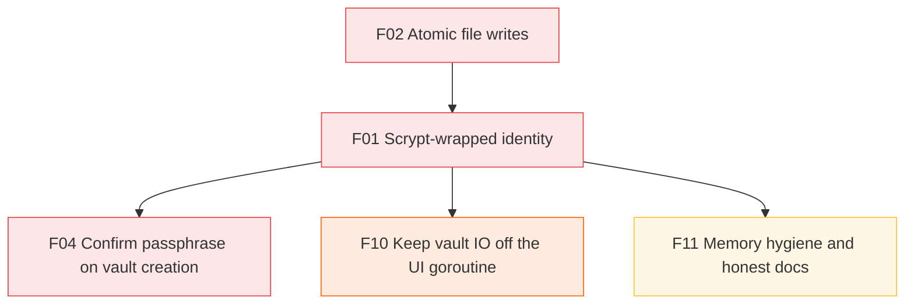
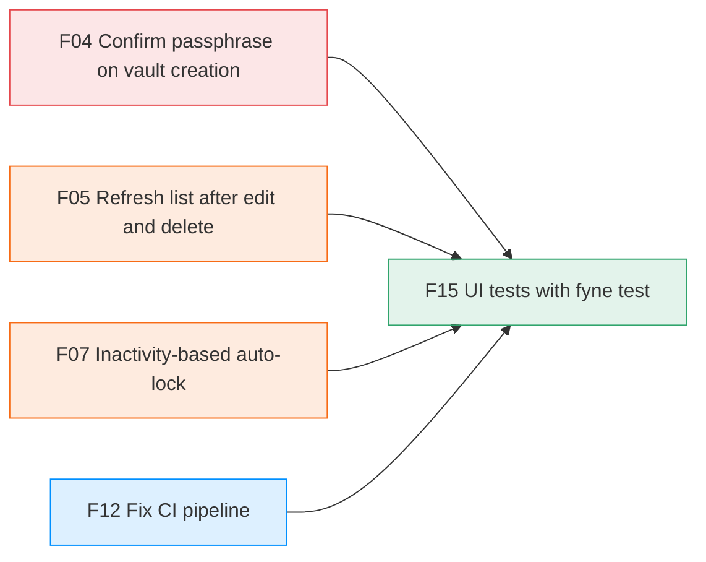
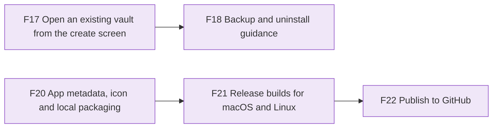
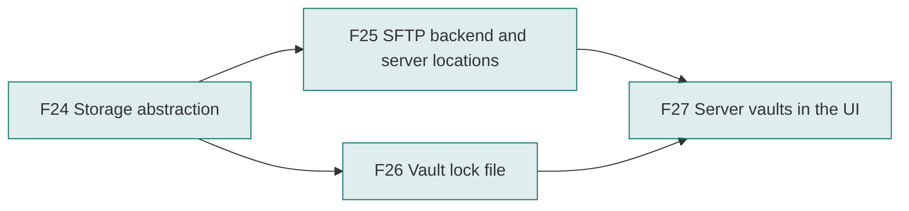
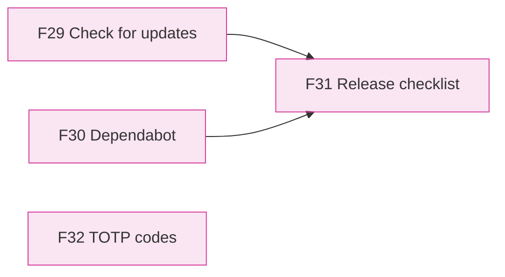

# Roadmap

The fix plan from the [[2026-10-27 Code Review]], in five phases, plus a sixth release phase, a seventh for vaults on a server, an eighth for updates and TOTP, and a ninth for architecture. Earlier phases unblock or de-risk later ones. Each fix is its own note in `Roadmap/Fixes/`, and its `status` property drives the tracker below.

> [!important] Why storage goes first
> [[F01 Scrypt-wrapped identity]] changes the on-disk format. Doing it before anyone has real vaults avoids writing a migration under pressure, and it removes the root cause of two critical findings.

## Dependency graph

**Storage chain.** Everything that depends on the new key design.

**UI test gate.** The behaviour these fixes add is what [[F15 UI tests with fyne test|F15]] tests.

Phase colours: ■ 1 storage · ■ 2 UI · ■ 3 memory · ■ 4 CI · ■ 5 tests · ■ 6 release · ■ 7 server · ■ 8 updates and TOTP · 9 architecture. An arrow `A → B` means *do A before B*. Click a node to open its note.

The other fixes have no ordering constraints and can be picked up at any point within their phase: [[F03 Prevent silent overwrites]], [[F06 Persist settings]], [[F08 Correct clipboard clearing]], [[F09 Fail import on read errors]], [[F13 Project hygiene]], [[F14 Remove reinvented stdlib and dead code]].

## Phases

### Phase 1: Storage & data safety
Goal: no operation can lose or strand a secret, and unlock costs one scrypt.
- [[F02 Atomic file writes]]: prerequisite for a safe migration
- [[F01 Scrypt-wrapped identity]]: see [[ADR-001 Scrypt-wrapped X25519 identity|ADR-001]]
- [[F03 Prevent silent overwrites]]
- [[F04 Confirm passphrase on vault creation]]

### Phase 2: UI correctness
Goal: the UI never freezes, never shows stale data, and never discards edits.
- [[F10 Keep vault IO off the UI goroutine]]
- [[F05 Refresh list after edit and delete]]
- [[F07 Inactivity-based auto-lock]]
- [[F08 Correct clipboard clearing]]
- [[F09 Fail import on read errors]]
- [[F06 Persist settings]]

### Phase 3: Memory hygiene
- [[F11 Memory hygiene and honest docs]]

### Phase 4: CI & project hygiene
These can run in parallel with phases 1–3.
- [[F12 Fix CI pipeline]]
- [[F13 Project hygiene]]

### Phase 5: Quality & tests
- [[F14 Remove reinvented stdlib and dead code]]
- [[F15 UI tests with fyne test]]

### Phase 6: Release
Added 2026-10-28. Goal: an installable macOS app and Linux AppImage, built on GitHub after CI passes. Windows packaging waits. The first three fixes come from verifying that a vault survives an uninstall and reinstall: it does, but a vault in a custom folder could look lost. [[F23 UI makeover]] came later, at the user's request (2026-10-29).
- [[F16 Keep group names as typed]]
- [[F17 Open an existing vault from the create screen]]
- [[F18 Backup and uninstall guidance]]
- [[F19 Follow XDG_DATA_HOME on Linux]]
- [[F20 App metadata, icon and local packaging]]
- [[F21 Release builds for macOS and Linux]]
- [[F22 Publish to GitHub]]
- [[F23 UI makeover]]

### Phase 7: Vaults on a server
Added 2026-10-29, at the user's request. Goal: a vault can live in a folder on an SSH server, reached with the system's ssh ([[ADR-002 Vaults on a server over the system ssh]]), with the local guarantees (atomic writes, no overwrites, private modes). No offline copy. A lock file warns when a vault is open twice. [[F28 About dialog for bug reports]] came later, at the user's request (2026-10-29).
- [[F24 Storage abstraction]]
- [[F25 SFTP backend and server locations]]
- [[F26 Vault lock file]]
- [[F27 Server vaults in the UI]]
- [[F28 About dialog for bug reports]]

### Phase 8: Updates and TOTP
Added 2026-11-01, at the user's request. Goal: users can find out about new releases without vlt ever updating itself, dependencies stay current, releases follow a written checklist, and records with a TOTP secret show the current code.
- [[F29 Check for updates]]
- [[F30 Dependabot]]
- [[F31 Release checklist]]
- [[F32 TOTP codes]]

### Phase 9: Architecture
Added 2026-11-11, from an architecture review (deepening opportunities in the churn hot spots). Goal: deep modules with small interfaces, so changes and tests concentrate in one place.
- [[F33 Vault session module]]

### Phase 10: Go skills audit
Added 2026-11-11, from an audit with the samber Go skills (security, safety, concurrency, tests, tooling). Goal: fix the five findings that matter most.
- [[F34 Tampered vault files]]
- [[F35 Location round trip]]
- [[F36 Private exports]]
- [[F37 Lock read errors]]
- [[F38 Secret list errors]]

### Phase 11: Deepening, second pass
Added 2026-11-11. Goal: deep modules for the error wording, operations, secret files and settings, from the second architecture review.
- [[F39 Secret files and keys]]
- [[F40 Error wording]]
- [[F41 Operations]]
- [[F42 Settings module]]

### Phase 12: Audit leftovers
Added 2026-11-12, from the rest of the Go skills audit. Goal: close the remaining security and data-safety findings, then tighten CI.
- [[F43 Scrypt work factor cap]]
- [[F44 Auto-lock during long operations]]
- [[F45 Lock without freezing]]
- [[F46 Tests on every OS]]
- [[F47 Workflow linters]]
- [[F48 nolintlint]]

### Phase 13: Deepening, third pass
Added 2026-11-12, from the third architecture review. Goal: the store owns its lock file, one module opens a vault, vault-wide changes report their outcome, and one module owns the main view.
- [[F49 Store owns its lock file]]
- [[F50 Opening a vault]]
- [[F51 Vault-wide changes]]
- [[F52 Main view]]

## Tracker

![[Roadmap.base]]

## Progress

Each fix note's `status` property is one of `todo`, `in-progress`, or `done`. The **Progress** view in the tracker counts them by phase.

> [!success] Phases 1–5 are done (2026-10-27)
> All 15 review fixes went through independent code, documentation and tooling verification before their commits, and were merged into `main`.

> [!success] Phase 6 is done (2026-10-29)
> [vlt 0.1.0](https://github.com/heyjdp/vlt/releases/tag/v0.1.0) is released with the macOS app and the AppImage. The `yourorg` placeholders were then renamed in [[F22 Publish to GitHub]].

> [!success] Phase 8 is done (2026-11-01)
> [[F29 Check for updates]], [[F30 Dependabot]], [[F31 Release checklist]] and [[F32 TOTP codes]] each went through code, documentation and tooling verification before their commits. They were merged into `main` but not yet pushed. The next release is 0.2.0: Unreleased has new features.

> [!success] Phase 10 is done (2026-11-11)
> [[F34 Tampered vault files]], [[F35 Location round trip]], [[F36 Private exports]], [[F37 Lock read errors]] and [[F38 Secret list errors]] each went through code, documentation and tooling verification before their commits, and were merged into `main` but not yet pushed. Verification turned three of them into production fixes beyond the audit's finding (swapped secret files, four more location round-trip bugs, a Retry that could lose a save).

> [!success] Phase 11 is done (2026-11-11)
> [[F39 Secret files and keys]], [[F40 Error wording]], [[F41 Operations]] and [[F42 Settings module]] were built on the branch `refactor/deepen-ui-store`, each with its tests, documentation and lint passing, then went through independent code, documentation and tooling verification and were merged into `main` but not yet pushed. Besides the deeper modules, they fix a nested vault's key file counted as an unreadable secret and copied by Move, internal prefixes in error messages, *Move Vault* and *Switch Vault* overlapping a copy, a passphrase change during a copy, import over an unreadable file, and a location from `VLT_VAULT_DIR` shown in another form than vlt writes.
> Verification found, and fixed before the merge: a server vault's error messages without the file's name, a garbled message when a hard link and its fallback both fail, context lost from three messages (`vlt.json`, a temp folder's mode, the secret now holding a file), a prefix that repeats its cause, and an exported file's plaintext left unwiped when the vault locks just as decoding finishes. It also added tests for `CopyTo`'s failure paths, the folder chooser, Settings' Move errors and the file secret guards.

> [!success] Phase 12 is done (2026-11-12)
> [[F43 Scrypt work factor cap]], [[F44 Auto-lock during long operations]], [[F45 Lock without freezing]], [[F46 Tests on every OS]], [[F47 Workflow linters]] and [[F48 nolintlint]] each went through code, documentation and tooling verification and were merged into `main` and pushed. The first CI run on Windows found a real bug (a file given as the vault location read as an empty folder), fixed and verified the same way; CI is now green on Linux, macOS and Windows.

> [!success] Phase 13 is done (2026-11-12)
> [[F49 Store owns its lock file]], [[F50 Opening a vault]], [[F51 Vault-wide changes]] and [[F52 Main view]] were built on the branch `refactor/deepen-open-and-lock`, each with its tests, documentation and lint passing, then went through independent code, documentation and tooling verification and were merged into `main`. Besides the deeper modules (the store owning its lock file, one module opening a vault, vault changes reporting their outcome, one main-view module with one wipe), they fix a passphrase change's outcome being guessed from the error (a change that lost its server connection before the new key was sent is now reported as a failed change, and a local change whose folder couldn't be synced as possibly saved).
> Verification found no regressions and no flaky tests. It added tests for a failed takeover (in the store and in *Open Anyway*), removed dead lock-error code, replaced a timed wait in a lock test with a `synctest` bubble, and corrected the documentation of the lock order, the vault-change outcomes and quitting during an unlock.
